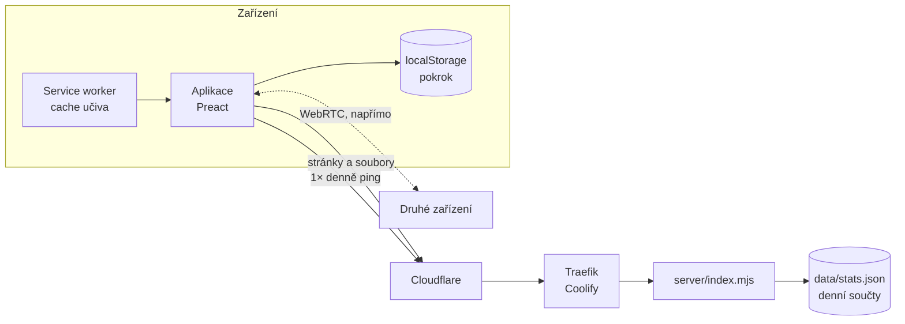

# Architektura

Technický popis pro vývojáře a pro každého, kdo chce vědět, jak aplikace uvnitř funguje.

## Přehled

Šprtám je **PWA** (webová aplikace, která jde nainstalovat a funguje offline). Skládá se ze dvou částí:

1. **Aplikace v prohlížeči.** Dělá všechno: zobrazuje učivo, vyhodnocuje kvízy, ukládá pokrok, doporučuje témata, propojuje zařízení.
2. **Malý server** ([`server/index.mjs`](../server/index.mjs), necelých 120 řádků bez závislostí). Jen posílá soubory aplikace a sčítá denní ping. Nemá databázi, účty ani logiku aplikace.



## Technologie

| Co | Čím |
|---|---|
| UI | [Preact](https://preactjs.com) 11 + TypeScript, bez dalších UI knihoven |
| Build | [Vite](https://vite.dev) |
| Offline | [vite-plugin-pwa](https://vite-pwa-org.netlify.app) (Workbox) |
| QR kódy | [`uqr`](https://github.com/unjs/uqr) (generování), [`qr-scanner`](https://github.com/nimiq/qr-scanner) (čtení kamerou) |
| Písma | Nunito, JetBrains Mono přes `@fontsource-variable` (součást buildu, nic se nestahuje z Google Fonts) |
| Server | Node.js 24, jen vestavěné moduly (`node:http`, `node:fs`) |
| Testy | skripty v [`scripts/`](../scripts) s [`playwright-core`](https://playwright.dev) |

Kompletní seznam závislostí: [`package.json`](../package.json).

## Struktura repozitáře

```
src/
  app.tsx, main.tsx     vstup aplikace, výběr obrazovky podle adresy
  router.tsx            směrování přes History API
  content/              načítání a formát učiva
    format.ts           formát JSON souborů (zdroj pravdy: typy, kontrola, JSON Schema)
    schema.ts           malý nástroj na schémata (typ + kontrola + JSON Schema z jedné definice)
    examples.ts         ukázka každého bloku a otázky (galerie, FORMAT.md)
    curriculum.ts       ročníky, předměty, barvy
    index.ts            načtení předmětu (jeden chunk na předmět)
  vocab/                slovíčka: načítání, přehrávání výslovnosti (speak.ts)
  approach.ts           přístupy k výuce (waldorf): data a volba dítěte (localStorage)
  quiz/                 režimy, vyhodnocení odpovědí, generátory příkladů
  progress/
    store.ts            pokrok v localStorage, slučování
    code.ts             kód pokroku (QR / odkaz)
    p2p.ts              propojení zařízení přes WebRTC
    recommend.ts        doporučení „Na řadě“
  screens/              obrazovky
  widgets/              interaktivní pomůcky: <název>.tsx = jeden widget, kit.tsx = standard a sdílené ovládání,
                        index.tsx = seznam
  ui/                   ikony, maskot, lišty
  stats.ts              denní anonymní ping
content/                učivo jako JSON (viz CONTENT.md)
  topics/<ročník>/<předmět>/_subject.json, <téma>.json
  vocab/<úroveň>.json
  approaches/<přístup>/ approach.json, <ročník>.json (plán: epochy a témata)
  schema/               JSON Schema pro editory (generované)
plugins/
  content.ts            čtení content/ v Node (pro build a skripty)
  content-modules.ts    virtual:content – jeden chunk na předmět
  prerender.ts          HTML stránka pro každé téma (sdílení, vyhledávače)
  topic-index.ts        lehký index všech témat pro hledání
server/index.mjs        produkční server
public/                 statické soubory, ikony, pomocné skripty
scripts/                kontroly obsahu a testy v prohlížeči
docs/                   tato dokumentace
```

## Jak se aplikace načítá

1. Prohlížeč otevře např. `/g/z5/matematika/zlomky`. Server vrátí **předrenderovanou stránku** s obsahem tématu ([`plugins/prerender.ts`](../plugins/prerender.ts)). Obsah je vidět hned, i bez JavaScriptu, a vyhledávače i náhledy odkazů dostanou titulek a popis.
2. Načte se aplikace a vykreslí stejnou obrazovku interaktivně.
3. Service worker na pozadí uloží celé učivo všech ročníků do cache. Každý předmět je při buildu spojený z JSON souborů svých témat do jednoho souboru ([`plugins/content-modules.ts`](../plugins/content-modules.ts)), takže se načítá jen to, co je potřeba, ale offline je k dispozici všechno.
4. Zavolá se denní ping ([Statistiky](STATISTIKY.md)).

Obrazovky bez vlastní stránky (kvíz, hledání, přenos pokroku) dostanou prázdnou kostru `app.html` s `noindex`. Neznámé adresy vrací 404.

### Adresy

| Adresa | Obrazovka |
|---|---|
| `/` | Domů |
| `/g/z5` | Ročník |
| `/g/z5/matematika` | Předmět |
| `/g/z5/matematika/zlomky` | Téma |
| `/g/z5/matematika/zlomky/kviz` | Režim (`kviz`, `opakovani`, `pisemka`, `zkouseni`) |
| `/g/z5/matematika/~test` | Test z předmětu |
| `/slovicka`, `/slovicka/A1` | Slovíčka, úroveň |
| `/slovicka/A1/0`, `/slovicka/A1/vse` | Procvičování jedné skupiny / všech skupin úrovně |
| `/hledat?q=…` | Hledání |
| `/mix` | Mix připnutých témat |
| `/sdilet` | Přenos pokroku |
| `/widgety`, `/widgety/<název>` | Galerie widgetů, bloků a otázek pro autory obsahu |
| `/waldorf`, `/waldorf/z1`, `/waldorf/z1/<epocha>` | Přístup k výuce: popis a volba, plán ročníku, epocha s tématy |
| `/waldorf/z1/<epocha>/test` | Procvičení všech témat epochy |
| `/#/p/<kód>`, `/#/spojit/<kód>`, `/#/presun/<kód>` | Import pokroku, párování, přechod ze staré domény (za `#`, server je nevidí) |

Staré odkazy z doby, kdy aplikace používala adresy za `#` (`/#/g/z5`), se automaticky převedou na nové ([`src/router.tsx`](../src/router.tsx)).

### Nové verze a cache

Po nasazení nové verze může mít telefon v cache starou stránku, která odkazuje na soubory, jež už neexistují. Aplikace to řeší sama:

- Stránky se berou ze sítě (`NetworkFirst`), z cache jen offline nebo když síť neodpoví do 5 sekund ([`vite.config.ts`](../vite.config.ts)).
- Když se aplikace nespustí do 4 sekund, [`public/boot-check.js`](../public/boot-check.js) smaže service worker a cache a stránku jednou přenačte. Pokrok v `localStorage` zůstane.
- Když stará stránka požádá o neexistující soubor `/assets/*.js`, server místo chyby 404 pošle tentýž „uzdravovací“ skript.

## Server

[`server/index.mjs`](../server/index.mjs) dělá jen tohle:

| Cesta | Co dělá |
|---|---|
| `POST /api/ping` | Zvýší denní počítadlo ([Statistiky](STATISTIKY.md)) |
| `GET /api/stats` | Vrátí denní součty, chráněno tokenem `STATS_TOKEN` |
| `GET /healthz` | Kontrola, že server běží |
| ostatní | Statické soubory z `dist/` |

Bezpečnostní hlavičky u všech stránek a souborů aplikace:

- `Content-Security-Policy: default-src 'self'; …`: prohlížeč smí načítat a volat jen `sprtam.cz`.
- `Referrer-Policy: no-referrer`: když z aplikace klikneš na odkaz jinam, cílový web se nedozví, odkud jdeš.
- `Permissions-Policy: camera=(self), microphone=(), geolocation=()`: kameru smí použít jen aplikace sama (QR kódy), mikrofon a poloha jsou zakázané.
- `X-Content-Type-Options: nosniff`.

Server nevede log požadavků, nenastavuje cookies a jediné, co zapisuje na disk, je `stats.json` (v produkci ve volume `/data`).

Stará adresa `sprtam.ondrejzraly.cz` vede na stejný server. Prohlížeči pošle skript, který přenese pokrok na `sprtam.cz` ([Propojení zařízení](PROPOJENI-ZARIZENI.md#přechod-ze-staré-adresy)), a ostatním (vyhledávačům) trvalé přesměrování 301.

## Nasazení

Produkce běží v Dockeru na vlastním serveru spravovaném přes [Coolify](https://coolify.io), před ním je Cloudflare.

1. Změna se dostane do větve `main` přes pull request.
2. Coolify automaticky sestaví [`Dockerfile`](../Dockerfile):
   - `npm ci`,
   - `npm run check:content` (kontrola učiva a widgetů; když selže, nasazení se zastaví),
   - `npm run build` (kontrola typů a produkční build),
   - výsledný obraz obsahuje jen `dist/` a `server/`.
3. Spustí kontejner s volume `/data` pro statistiky a ověří `/healthz`.

Produkční verze se tedy vždy staví přímo z veřejného zdrojového kódu tohoto repozitáře.

### Proměnné prostředí

| Proměnná | Kde | Význam |
|---|---|---|
| `VITE_STATS_URL` | build | Adresa pro denní ping. Bez ní se ping neposílá. V `Dockerfile` je `/api/ping`. |
| `SITE_URL` | build | Veřejná adresa pro odkazy v předrenderovaných stránkách a `sitemap.xml`, výchozí `https://sprtam.cz`. |
| `PORT` | server | Port, výchozí `8080`. |
| `DATA_DIR` | server | Složka pro `stats.json`, v Dockeru `/data`. |
| `STATS_TOKEN` | server | Token pro `/api/stats`. Bez něj je souhrn veřejný. |
| `LEGACY_HOSTS` | server | Domény, ze kterých se přesměrovává na `sprtam.cz`, výchozí `sprtam.ondrejzraly.cz` (stará adresa) a `www.sprtam.cz`. |
| `DIST` | server | Složka s buildem, výchozí `dist/`. |

## Vývoj

```sh
npm install
npm run dev              # http://localhost:5173
npm run check:content    # kontrola učiva (formát, widgety, odpovědi, pravidla výkladu)
npm run content:generate # content/schema/*.json, docs/FORMAT.md, docs/WIDGETY.md
npm run content:format   # sjednotí formátování JSON v content/
npm run build            # typy + produkční build do dist/
node server/index.mjs    # produkční server nad dist/ na :8080
```

Skripty v `scripts/` se spouštějí ručně, žádné automatické CI zatím není. `check-content.ts` a `check-quiz.ts` běží v Node, ostatní ovládají skutečný prohlížeč (Playwright Chromium; cesta k němu je nastavená pro macOS). Většina prohlížečových skriptů potřebuje běžící dev server na portu 5179 (`npx vite --port 5179`):

| Skript | Co ověřuje |
|---|---|
| `scripts/check-content.ts` | formát a správnost učiva, seznam widgetů, aktuálnost generovaných souborů (`npm run check:content`) |
| `scripts/content-generate.ts` | vygeneruje JSON Schema a reference FORMAT.md, WIDGETY.md (`npm run content:generate`) |
| `scripts/content-format.ts` | sjednotí formátování JSON (`npm run content:format`) |
| `scripts/check-quiz.ts` | že každá napsaná odpověď projde vlastní kontrolou |
| `scripts/flow.mjs` | průchod kvízem |
| `scripts/vocab-test.mjs` | slovíčka |
| `scripts/vocab-audio.ts` | nahrávky výslovnosti: `gen` nahraje chybějící přes ElevenLabs (klíč v `ELEVENLABS_API_KEY`), `build` je ořízne, srovná hlasitost a zapíše do `public/audio/en` a verzi do `src/vocab/audio.ts`, `check` je nechá přepsat řečí na text a porovná se slovíčkem |
| `scripts/p2p-test.mjs` | spojení dvou oddělených prohlížečů přes WebRTC |
| `scripts/code-test.mjs` | kód pokroku tam a zpět |
| `scripts/import-test.mjs` | import pokroku odkazem (proti produkci) |
| `scripts/routing-test.mjs` | adresy a navigace nad produkčním buildem |
| `scripts/verify-prod.mjs` | že produkce ukazuje všechna témata |
| `scripts/crawl.mjs` | otevře každé téma a hlásí chyby za běhu |
| `scripts/shots.mjs` | snímky obrazovek (přehled widgetů je v aplikaci na `/widgety`) |

Jak psát učivo: [CONTENT.md](CONTENT.md).
