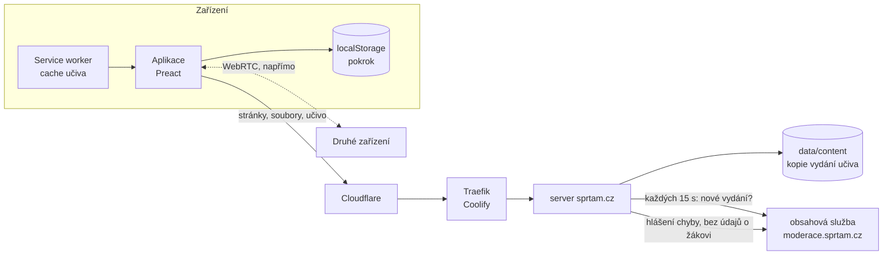

# Architektura

Technický popis pro vývojáře a pro každého, kdo chce vědět, jak aplikace uvnitř funguje.

## Přehled

Šprtám je **PWA** (webová aplikace, která jde nainstalovat a funguje offline). Skládá se ze tří částí:

1. **Aplikace v prohlížeči.** Dělá všechno: zobrazuje učivo, vyhodnocuje kvízy, ukládá pokrok, doporučuje témata, propojuje zařízení.
2. **Server sprtam.cz** ([`server/`](../server), jeden soubor bez závislostí). Posílá soubory aplikace, stránky a učivo. Nic nepočítá ani nezaznamenává. Nemá databázi uživatelů, účty ani logiku aplikace.
3. **Obsahová služba** (moderace, [moderace.sprtam.cz](https://moderace.sprtam.cz), [`moderator/`](../moderator)). Tady je učivo uložené: databáze s verzemi, kontrola a schvalování změn. Server sprtam.cz si z ní drží kopii aktuálního vydání učiva ([Obsah a jeho API](OBSAH.md)).

Žáci se obsahové služby nikdy nedotknou: všechno dostanou od serveru sprtam.cz.



## Technologie

| Co | Čím |
|---|---|
| UI | [Preact](https://preactjs.com) 11 + TypeScript, bez dalších UI knihoven |
| Build | [Vite](https://vite.dev) |
| Offline | [vite-plugin-pwa](https://vite-pwa-org.netlify.app) (Workbox) |
| QR kódy | [`uqr`](https://github.com/unjs/uqr) (generování), [`qr-scanner`](https://github.com/nimiq/qr-scanner) (čtení kamerou) |
| Písma | Nunito, JetBrains Mono přes `@fontsource-variable` (součást buildu, nic se nestahuje z Google Fonts) |
| Server | Node.js 24, jen vestavěné moduly (`node:http`, `node:fs`, `node:zlib`); sestavený Vite do jednoho souboru |
| Testy | skripty v [`scripts/`](../scripts) s [`playwright-core`](https://playwright.dev) |

Kompletní seznam závislostí: [`package.json`](../package.json).

## Struktura repozitáře

```
src/
  app.tsx, main.tsx     vstup aplikace, výběr obrazovky podle adresy
  router.tsx            směrování přes History API
  content/              načítání a formát učiva
    format.ts           formát JSON souborů (zdroj pravdy: typy, kontrola, JSON Schema)
    schema.ts           malý nástroj na schémata (typ + kontrola + JSON Schema z jedné definice)
    examples.ts         ukázka každého bloku a otázky (galerie, FORMAT.md)
    curriculum.ts       ročníky, předměty, barvy
    index.ts            načtení předmětu (jeden chunk na předmět)
  vocab/                slovíčka: načítání, přehrávání výslovnosti (speak.ts)
  approach.ts           přístupy k výuce (waldorf): data a volba dítěte (localStorage)
  exam.ts               příprava na přijímačky (/prijimacky): oblasti testů a jejich témata
  obory.ts              obory odborných škol (/obor): odborné a všeobecné předměty po ročnících (docs/OBORY.md)
  maps/                 Slepá mapa (/slepa-mapa): mapy a české názvy (places.ts), mapa s posunem a zoomem (MapView.tsx),
                        obrysy z Natural Earth v data/*.json (npx tsx scripts/maps-generate.ts)
  chem/                 Periodická tabulka (/periodicka-tabulka): 118 prvků (elements.ts, sdílí je widgety periodic a chem-equation),
                        sady a hry (index.ts), slepá tabulka (Table.tsx)
  quiz/                 režimy, vyhodnocení odpovědí, generátory příkladů
  games.ts              hry a příprava (mapa, tabulka, slovíčka, přijímačky) a ke kterým předmětům patří
  school.ts             Moje škola: druhý jazyk, předměty ročníku
  progress/
    store.ts            pokrok v localStorage, slučování
    code.ts             kód pokroku (QR / odkaz)
    p2p.ts              propojení zařízení přes WebRTC
    recommend.ts        doporučení „Na řadě“, série dní
    questions.ts        opakování jednotlivých otázek (Sešit chyb, Dnešní opakování)
  screens/              obrazovky
  widgets/              interaktivní pomůcky: <název>.tsx = jeden widget, kit.tsx = standard a sdílené ovládání,
                        index.tsx = seznam
  ui/                   ikony, maskot, lišty
content/                místní kopie učiva (npm run content:pull, není v gitu; viz OBSAH.md)
  topics/<ročník>/<předmět>/_subject.json, <téma>.json
  vocab/<úroveň>.json
  approaches/<přístup>/ approach.json, <ročník>.json (plán: epochy a témata)
  schema/               JSON Schema pro editory (generované, v gitu)
plugins/
  content.ts            čtení content/ v Node (pro skripty)
  content-dev.ts        API učiva při vývoji (z content/, nebo z obsahové služby)
server/
  index.ts              produkční server
  content.ts            kopie aktuálního vydání učiva z obsahové služby
  pages.ts              HTML stránka pro každé téma (sdílení, vyhledávače)
moderator/              moderace: editor učiva pro pozvané moderátory (docs/MODERACE.md)
public/                 statické soubory, ikony, pomocné skripty
scripts/                kontroly obsahu a testy v prohlížeči
docs/                   tato dokumentace
```

## Jak se aplikace načítá

1. Prohlížeč otevře např. `/g/z5/matematika/zlomky`. Server vrátí **hotovou stránku** s obsahem tématu ([`server/pages.ts`](../server/pages.ts)), vykreslenou z aktuálního vydání učiva. Obsah je vidět hned, i bez JavaScriptu, a vyhledávače i náhledy odkazů dostanou titulek a popis. Ve stránce je i manifest vydání (seznam souborů učiva, [Obsah a jeho API](OBSAH.md#api-pro-aplikaci)).
2. Načte se aplikace a vykreslí stejnou obrazovku interaktivně. Učivo si bere z API po souborech: jeden soubor na předmět, takže se načítá jen to, co je potřeba.
3. Až má prohlížeč volnou chvíli, aplikace uloží do cache všechny soubory aktuálního vydání, takže offline je k dispozici celé učivo všech ročníků ([`src/content/remote.ts`](../src/content/remote.ts)).

Obrazovky bez vlastní stránky (kvíz, hledání, přenos pokroku) dostanou prázdnou kostru `app.html` s `noindex`. Neznámé adresy vrací 404.

Nové vydání učiva (schválená změna v moderaci) je na sprtam.cz do 15 sekund. Otevřená aplikace si ho všimne, když se k ní vrátíš, nebo nejpozději za 10 minut; obrazovky, které už máš otevřené, se nemění pod rukama.

### Adresy

| Adresa | Obrazovka |
|---|---|
| `/` | Domů: Teď na řadě, předměty mé školy a hry k nim |
| `/ucivo` | Učivo: všechny třídy, obory, přístupy, příprava |
| `/hry` | Hry (`src/games.ts`) |
| `/ja` | Já: pokrok, profily, nastavení |
| `/skola` | Moje škola: ročník, obor, druhý jazyk, způsob výuky (`src/school.ts`) |
| `/g/z5` | Ročník |
| `/g/z5/matematika` | Předmět |
| `/g/z5/matematika/zlomky` | Téma |
| `/g/z5/matematika/zlomky/kviz` | Režim (`kviz`, `opakovani`, `pisemka`, `zkouseni`) |
| `/g/z5/matematika/~test` | Test z předmětu |
| `/slovicka`, `/slovicka/A1` | Slovíčka, úroveň (angličtina) |
| `/slovicka/nemcina`, `/slovicka/nemcina/A1` | slovíčka dalšího jazyka a jeho úroveň (`src/vocab/langs.ts`) |
| `/slovicka/A1/0`, `/slovicka/A1/vse` | Procvičování jedné skupiny / všech skupin úrovně |
| `/hledat?q=…` | Hledání |
| `/mix` | Mix připnutých témat |
| `/dnes` | Dnešní opakování: otázky na řadě ze všech témat |
| `/chyby`, `/chyby/procvicit` | Sešit chyb a jeho procvičení |
| `/prehled` | Přehled: série, dnešní cíl, hvězdičky po předmětech |
| `/sdilet` | Přenos pokroku |
| `/nastaveni` | Nastavení: profily, vzhled, čtení, denní cíl |
| `/widgety`, `/widgety/<název>` | Galerie widgetů, bloků a otázek pro autory obsahu |
| `/slepa-mapa`, `/slepa-mapa/evropa` | Slepá mapa: mapy, jedna mapa (prohlížení, seznam míst) |
| `/slepa-mapa/evropa/najdi` | Hra (`najdi`, `mesta`, `poznej`; `?vse` = celá mapa) |
| `/periodicka-tabulka` | Periodická tabulka: prohlížení, sady prvků (`?sada=zaklad`, `zs`, `vse`), hry a seznam prvků |
| `/periodicka-tabulka/zs/znacky` | Hra (`znacky`, `nazvy`, `najdi`, `poznej`, `druh`; `?vse` = všechny prvky sady) |
| `/waldorf`, `/waldorf/z1`, `/waldorf/z1/<epocha>` | Přístup k výuce: popis a volba, plán ročníku, epocha s tématy |
| `/waldorf/z1/<epocha>/test` | Procvičení všech témat epochy |
| `/#/p/<kód>`, `/#/spojit/<kód>`, `/#/presun/<kód>` | Import pokroku, párování, přechod ze staré domény (za `#`, server je nevidí) |

Staré odkazy z doby, kdy aplikace používala adresy za `#` (`/#/g/z5`), se automaticky převedou na nové ([`src/router.tsx`](../src/router.tsx)).

### Nové verze a cache

Po nasazení nové verze může mít telefon v cache starou stránku, která odkazuje na soubory, jež už neexistují. Aplikace to řeší sama:

- Stránky se berou ze sítě (`NetworkFirst`), z cache jen offline nebo když síť neodpoví do 5 sekund ([`vite.config.ts`](../vite.config.ts)).
- Když se aplikace nespustí do 4 sekund, [`public/boot-check.js`](../public/boot-check.js) smaže service worker a cache a stránku jednou přenačte. Pokrok v `localStorage` zůstane.
- Když stará stránka požádá o neexistující soubor `/assets/*.js`, server místo chyby 404 pošle tentýž „uzdravovací“ skript.

## Server

[`server/index.ts`](../server/index.ts) dělá jen tohle:

| Cesta | Co dělá |
|---|---|
| `POST /api/report` | Hlášení chyby v učivu od žáka: zkontroluje ho, omezí počet z jednoho zařízení a pošle obsahové službě bez adresy a čehokoli o žákovi ([Hlášení chyb od žáků](OBSAH.md#hlášení-chyb-od-žáků)) |
| `GET /api/content/manifest`, `GET /api/content/f/<hash>.json` | Učivo pro aplikaci ([API pro aplikaci](OBSAH.md#api-pro-aplikaci)) |
| `GET /healthz` | Kontrola, že server běží |
| stránky, `sitemap.xml`, `robots.txt` | Vykreslené z aktuálního vydání učiva ([`server/pages.ts`](../server/pages.ts)) |
| ostatní | Statické soubory z `dist/` |

Bezpečnostní hlavičky u všech stránek a souborů aplikace:

- `Content-Security-Policy: default-src 'self'; …`: prohlížeč smí načítat a volat jen `sprtam.cz`.
- `Referrer-Policy: no-referrer`: když z aplikace klikneš na odkaz jinam, cílový web se nedozví, odkud jdeš.
- `Permissions-Policy: camera=(self), microphone=(), geolocation=()`: kameru smí použít jen aplikace sama (QR kódy), mikrofon a poloha jsou zakázané.
- `X-Content-Type-Options: nosniff`.

Server nevede log požadavků, nenastavuje cookies a na disk (v produkci volume `/data`) zapisuje jen kopii vydání učiva (`content/`).

Stará adresa `sprtam.ondrejzraly.cz` vede na stejný server. Prohlížeči pošle skript, který přenese pokrok na `sprtam.cz` ([Propojení zařízení](PROPOJENI-ZARIZENI.md#přechod-ze-staré-adresy)), a ostatním (vyhledávačům) trvalé přesměrování 301.

## Moderace

Učivo upravují pozvaní moderátoři v samostatné aplikaci [moderace.sprtam.cz](https://moderace.sprtam.cz) ([`moderator/`](../moderator), vlastní Dockerfile a kontejner), která je zároveň obsahovou službou: učivo se všemi verzemi je v její databázi a každou změnu schvaluje jiný moderátor. Server sprtam.cz z ní jen čte veřejné API vydání učiva; nic jiného o moderaci neví a nemá k ní žádný přístup. Podrobně: [Moderace](MODERACE.md), [Obsah a jeho API](OBSAH.md).

## Nasazení

Produkce běží v Dockeru na vlastním serveru spravovaném přes [Coolify](https://coolify.io), před ním je Cloudflare.

1. Změna se dostane do větve `main` přes pull request.
2. Coolify automaticky sestaví [`Dockerfile`](../Dockerfile):
   - `npm ci`,
   - `npm run build` (kontrola typů, build aplikace do `dist/` a serveru do `dist-server/`),
   - výsledný obraz obsahuje jen `dist/` a `dist-server/`, žádné učivo.
3. Spustí kontejner s volume `/data` (kopie učiva) a ověří `/healthz`.

Produkční verze aplikace se tedy vždy staví přímo z veřejného zdrojového kódu tohoto repozitáře. Učivo se nasazuje zvlášť: schválením v moderaci (bez buildu, do 15 sekund).

### Proměnné prostředí

| Proměnná | Kde | Význam |
|---|---|---|
| `SITE_URL` | server | Veřejná adresa pro odkazy ve stránkách a `sitemap.xml`, výchozí `https://sprtam.cz`. |
| `CONTENT_API` | server | Obsahová služba, ze které server bere učivo, výchozí `https://moderace.sprtam.cz`. Při vývoji i pro `npm run content:pull`. |
| `PORT` | server | Port, výchozí `8080`. |
| `DATA_DIR` | server | Složka pro kopii učiva (`content/`), v Dockeru `/data`. |
| `REPORT_TOKEN` | server | Token, se kterým server posílá hlášení chyb obsahové službě (stejný jako u moderace). Bez něj hlášení nejdou poslat. |
| `LEGACY_HOSTS` | server | Domény, ze kterých se přesměrovává na `sprtam.cz`, výchozí `sprtam.ondrejzraly.cz` (stará adresa) a `www.sprtam.cz`. |
| `DIST` | server | Složka s buildem, výchozí `dist/`. |

## Vývoj

```sh
npm install
npm run content:pull     # místní kopie aktuálního učiva do content/ (z CONTENT_API)
npm run dev              # http://localhost:5173, učivo z content/ (bez něj z obsahové služby)
npm run check:content    # kontrola učiva (formát, widgety, odpovědi, pravidla výkladu)
npm run content:generate # content/schema/*.json, docs/FORMAT.md, docs/WIDGETY.md
npm run content:format   # sjednotí formátování JSON v content/
npm run build            # typy + build aplikace do dist/ a serveru do dist-server/
npm start                # produkční server na :8080 (učivo z CONTENT_API)
npx tsx scripts/content-stub.ts  # náhrada obsahové služby nad content/ na :8097 (pro testy: CONTENT_API=http://localhost:8097)
```

Vývojový server čte učivo z `content/` a po každé změně souboru stránku obnoví, takže se dá zkoušet i obsah, který ještě není v moderaci ([`plugins/content-dev.ts`](../plugins/content-dev.ts)).

Skripty v `scripts/` se spouštějí ručně, žádné automatické CI zatím není. `check-content.ts` a `check-quiz.ts` běží v Node, ostatní ovládají skutečný prohlížeč (Playwright Chromium; cesta k němu je nastavená pro macOS). Většina prohlížečových skriptů potřebuje běžící dev server na portu 5179 (`npx vite --port 5179`):

| Skript | Co ověřuje |
|---|---|
| `scripts/check-content.ts` | formát a správnost učiva, seznam widgetů, aktuálnost generovaných souborů (`npm run check:content`) |
| `scripts/content-generate.ts` | vygeneruje JSON Schema a reference FORMAT.md, WIDGETY.md (`npm run content:generate`) |
| `scripts/content-format.ts` | sjednotí formátování JSON (`npm run content:format`) |
| `scripts/check-quiz.ts` | že každá napsaná odpověď projde vlastní kontrolou |
| `scripts/flow.mjs` | průchod kvízem |
| `scripts/vocab-test.mjs` | slovíčka |
| `scripts/vocab-check-test.ts` | psané odpovědi slovíček ve všech jazycích (diakritika, rod v závorce) a názvy nahrávek |
| `scripts/vocab-audio.ts` | nahrávky výslovnosti: `gen` nahraje chybějící přes ElevenLabs (klíč v `ELEVENLABS_API_KEY`), `build` je ořízne, srovná hlasitost a zapíše do `public/audio/<jazyk>` a verzi do `src/vocab/audio.ts` (`--lang de,fr` jen některé jazyky), `check` je nechá přepsat řečí na text a porovná se slovíčkem |
| `scripts/p2p-test.mjs` | spojení dvou oddělených prohlížečů přes WebRTC |
| `scripts/code-test.mjs` | kód pokroku tam a zpět |
| `scripts/import-test.mjs` | import pokroku odkazem (proti produkci) |
| `scripts/routing-test.mjs` | adresy a navigace nad produkčním buildem |
| `scripts/offline-test.mjs` | po jedné návštěvě funguje offline celé učivo (nad produkčním buildem) |
| `scripts/verify-prod.mjs` | že produkce ukazuje všechna témata svého vydání |
| `scripts/crawl.mjs` | otevře každé téma a hlásí chyby za běhu |
| `scripts/content-pull.ts` | stáhne aktuální vydání učiva do `content/` (`npm run content:pull`) |
| `scripts/content-update.ts` | pošle změněná zveřejněná témata z `content/` do moderace jako úpravy, s `--unverified` je správce rovnou zveřejní jako neověřená ([OBSAH.md](OBSAH.md#neověřené-učivo)) |
| `scripts/content-stub.ts` | náhrada veřejného API obsahové služby nad `content/` (pro testy serveru) |
| `scripts/learning-test.ts` | pravidla opakování otázek, Sešitu chyb, denního cíle, série se zmrazeným dnem a slučování (`npx tsx`) |
| `scripts/learning-flow.mjs` | totéž v prohlížeči: kvíz s chybou a nápovědou, Sešit chyb, Přehled, denní cíl, hlášení chyby (proti běžícímu serveru, `SHOTS=1` uloží snímky) |
| `scripts/usability-test.ts` | pravidla Plánu před písemkou, rozložení Ostré simulace do oblastí, rozdělané kolo, soubory `.ics` a přepínání profilů (`npx tsx`) |
| `scripts/usability-flow.mjs` | totéž v prohlížeči: nastavení čtení, klávesy, rozdělané kolo, simulace, pracovní list a tisk, plán s kalendářem, připomínka, profily (proti běžícímu serveru, `SHOTS=1` uloží snímky) |
| `scripts/maps-test.mjs` | Slepá mapa v prohlížeči: celá kola všech her dotykem, špatné klepnutí, výsledek a rekord, prohlížení mapy, posun a zoom myší (proti vývojovému serveru, `SHOTS=1` uloží snímky) |
| `scripts/elements-test.mjs` | Periodická tabulka v prohlížeči: celá kola všech her dotykem s jednou chybou, výsledek, rekord a procvičení chyb, slepá tabulka na telefonu, prohlížení a sady, klávesnice a tmavý vzhled na počítači (proti vývojovému serveru, `SHOTS=1` uloží snímky) |
| `scripts/selection-report-flow.mjs` | hlášení z označeného textu v prohlížeči (myš i dotyk): tlačítko pod označením, výběr zůstává, označený text dojde moderaci (spouští vlastní server, napřed `npm run build`) |
| `scripts/report-test.mjs` | hlášení chyb přes server: kontrola, limity, přeposlání bez údajů o žákovi (spouští vlastní server a náhradu obsahové služby, napřed `npm run build`) |
| `scripts/moderator-test.mjs` | moderace a obsahová služba: přihlášení klíčem, bezpečnostní pravidla, editor a náhled, kontrola a zveřejnění, historie a návraty, API tokeny, hlášení od žáků, zálohy (spouští vlastní server, napřed `npm run moderator:build`) |
| `scripts/shots.mjs` | snímky obrazovek (přehled widgetů je v aplikaci na `/widgety`) |

Jak psát učivo: [CONTENT.md](CONTENT.md).
