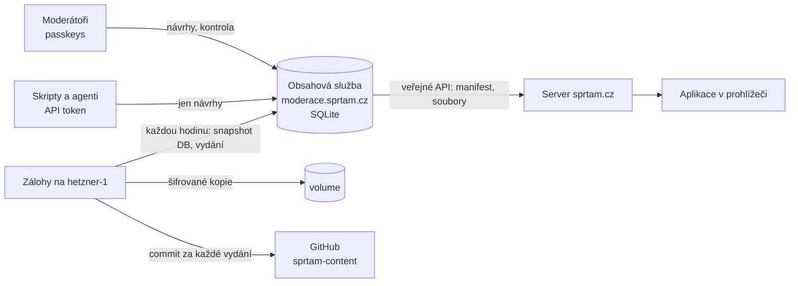

# Obsah a jeho API

Učivo Šprtámu (témata, slovíčka, plány přístupů k výuce) žije v databázi **obsahové služby**. Je to tentýž server jako [moderace](MODERACE.md) na **moderace.sprtam.cz** ([`moderator/server/`](../moderator/server)). Každá změna se ukládá jako nová verze a nic se nepřepisuje. Zveřejňuje se až po schválení jiným moderátorem. Aplikace na sprtam.cz čte učivo z veřejného API služby. Zálohy si každou hodinu stahuje druhý server.



## Dokumenty, verze, vydání

**Dokument** je jeden JSON s adresou podle dřívější cesty souboru ([`src/content/docs.ts`](../src/content/docs.ts)):

| Klíč | Obsah |
|---|---|
| `topics/<ročník>/<předmět>/<id>` | jedno téma |
| `topics/<ročník>/<předmět>/_subject` | pořadí témat předmětu |
| `vocab/<a1…c1>` | slovíčka jedné úrovně |
| `approaches/<id>/approach`, `approaches/<id>/<ročník>` | přístup k výuce a jeho plán ročníku |

Formát dokumentů se nezměnil ([FORMAT.md](FORMAT.md)).

- **Verze.** Každé zveřejnění dokumentu je nová verze (`versions`). Tabulka verzí jde jen doplňovat: SQLite triggery odmítnou každý `UPDATE` i `DELETE`.
- **Hash řetěz.** Každá verze nese SHA-256 svého obsahu a **řetěz**, tedy hash předchozího řetězu a údajů verze (klíč, číslo, hash obsahu, autor, vydání, důvod, čas). Kdo by historii přepsal, musí přepočítat řetěz až do konce. Záloha si pamatuje řetěz poslední verze, kterou viděla, a přepsání odhalí (viz [Zálohy](#zálohy)). Kontrolu ukazuje i moderace (Vydání → Historie) a příkaz `cli.mjs verify`.
- **Vydání** (`releases`) je jedno zveřejnění: jedna nebo víc nových verzí najednou, např. nové téma i s pořadím v předmětu. Vydání se číslují od 1. Vydání 1 je import učiva z repozitáře při prvním spuštění.
- **Kontrola před zveřejněním.** Před každým vydáním se zkontroluje celé učivo i se změnou, a to stejnou kontrolou jako `npm run check:content` ([`src/content/check.ts`](../src/content/check.ts)). Formát a pravidla se kontrolují u změněných dokumentů, vazby mezi dokumenty u všech: každé téma je v seznamu předmětu právě jednou, plány přístupů ukazují na existující témata, anglická slovíčka jsou jedinečná. Co neprojde, nezveřejní se.

## Zveřejnění: kontrola jiným moderátorem

1. Moderátor upraví téma v editoru (návrh, `drafts`) a pošle ho **ke kontrole**.
2. Ostatní moderátoři ho uvidí v **Ke kontrole**: změny proti verzi, ze které autor vycházel, po slovech, a návrh v telefonu. Můžou **komentovat** konkrétní blok nebo otázku, **požádat o úpravy**, nebo **schválit**.
3. Když schválí dost lidí (`REQUIRED_APPROVALS`, výchozí 1, autor se nepočítá) a nikdo nežádá úpravy, změna se **hned zveřejní** jako nové vydání.
4. Schvaluje se konkrétní **revize**. Každá úprava návrhu je nová revize a dřívější schválení i požadavky na úpravy pro ni neplatí.
5. **Konflikt:** když mezitím někdo zveřejnil jinou změnu téhož tématu, návrh nejde schválit. Autor uvidí, co se zveřejnilo, přenese to do svého návrhu a převede ho na novou verzi.

Správce může návrh zamítnout s důvodem.

## Historie a návraty

- **Historie tématu** (Učivo → téma → Historie): všechny verze, kdo je změnil a kdo schválil, a co každá verze změnila (nebo rozdíl proti zveřejněné).
- **Návrat ke starší verzi** je obyčejný návrh se starším obsahem a prochází stejnou kontrolou.
- **Správce v naléhavém případě** (s čerstvým potvrzením klíčem a s důvodem):
  - vrátí verzi tématu **hned bez kontroly**;
  - obnoví **celé učivo** do stavu po některém vydání (Vydání → Obnovit).

  Obojí je nové vydání. Nic se neztratí a jde to zase vrátit.

## Veřejné API obsahové služby

Bez přihlášení, jen pro čtení. Z něj si kopii drží server sprtam.cz (viz API pro aplikaci).

| Požadavek | Odpověď |
|---|---|
| `GET /api/public/v1/manifest` | manifest aktuálního vydání ([`src/content/manifest.ts`](../src/content/manifest.ts)), `ETag` a `304` |
| `GET /api/public/v1/files/<hash>` | soubor vydání podle hashe, `immutable`, gzip |
| `GET /api/public/v1/export` | všechny dokumenty aktuálního vydání `{ release, publishedAt, docs: { klíč: dokument } }` (`npm run content:pull`), nejvýš 30× za hodinu z jedné adresy |

## API pro moderování

Všechno, co umí moderace, jde přes JSON API na `https://moderace.sprtam.cz/api/…`. Prohlížeč posílá session cookie. Každý měnící požadavek musí mít přesně náš `Origin`, jinak skončí `403`.

**Skripty a AI agenti** (třeba ti, kdo píšou nové učivo) používají **API token**: Moderace → Účet → API tokeny. Token se zobrazí jen jednou a platí 7–180 dní. Posílá se v hlavičce `Authorization: Bearer spt_…`. Token patří moderátorovi a umí jen část toho, co on:

| Token smí | Token nesmí |
|---|---|
| číst učivo a historii (`GET /api/content/…`, `/api/history/…`, `/api/versions/:id`) | schvalovat, komentovat, žádat o úpravy |
| zakládat a upravovat **vlastní** návrhy (`POST /api/drafts`, `PUT /api/drafts/:id`) | zveřejňovat, vracet verze, obnovovat vydání |
| posílat je ke kontrole a zpět (`POST /api/drafts/:id/submit`, `/withdraw`, `/rebase`), mazat rozpracované | spravovat moderátory, tokeny a klíče |

Návrh od agenta pak musí schválit **někdo jiný než vlastník tokenu**. Agent tedy nikdy nezveřejní nic, co neviděl člověk.

Příklad: úprava tématu agentem.

```sh
API=https://moderace.sprtam.cz; H="Authorization: Bearer $SPRTAM_TOKEN"
# 1. návrh úpravy (nebo pokračování v mém otevřeném návrhu tématu)
curl -s -X POST "$API/api/drafts" -H "$H" -H 'Content-Type: application/json' \
  -d '{"kind":"edit","grade":"z6","subject":"matematika","topicId":"prvocisla"}' > draft.json
# 2. uložit nový obsah: { topic, rev } – rev z odpovědi, při souběžné změně 409 "stale"
curl -s -X PUT "$API/api/drafts/$ID" -H "$H" -H 'Content-Type: application/json' -d @body.json
# 3. ke kontrole (422 + seznam problémů, když téma neprojde kontrolou)
curl -s -X POST "$API/api/drafts/$ID/submit" -H "$H" -H 'Content-Type: application/json' -d '{"note":"Doplněny příklady"}'
```

Nové téma: `POST /api/drafts` s `{ "kind": "new", "grade", "subject", "topic": {…celé téma…}, "after": "<id tématu, za které patří>" }`. Kontrola tématu je stejná jako `npm run check:content -- topics/<ročník>/<předmět>` nad místní kopií (`npm run content:pull`).

Ostatní endpointy jsou v [`moderator/server/index.ts`](../moderator/server/index.ts): review, historie, vydání, žádosti o pomůcky, správa.

## Zálohy

Zálohy si **stahuje druhý server** (`hetzner-1`, kontejner `sprtam-backup` v Coolify, kód v [`ops/backup/`](../ops/backup)). Obsahová služba nemá k zálohám ani k zrcadlu žádný přístup, takže je nemůže smazat ani přepsat.

Každou hodinu:

1. **Stažení.** Stáhne snapshot celé databáze (`GET /api/internal/backup`, `VACUUM INTO`, gzip) s vlastním tokenem `BACKUP_TOKEN`.
2. **Ověření:**
   - SHA-256 sedí s ohlášeným;
   - SQLite `integrity_check` je v pořádku;
   - přepočítaný hash řetěz sedí u všech verzí;
   - historie jen přibyla: verze, kterou viděl naposledy, má pořád stejný řetěz.
3. **Uložení.** Uloží snapshot zašifrovaný nástrojem [age](https://age-encryption.org). Na serveru je jen veřejný klíč, privátní je v Keychainu správce (`sprtam-backup-age`) a v `~/.config/sprtam/backup-age-identity.txt` na jeho Macu. Ponechá posledních 48 hodinových, 35 denních a 24 měsíčních záloh. Když kontrola selže, nic starého nemaže.
4. **Zrcadlo.** Každé nové vydání zapíše jako commit do soukromého repozitáře **`mrpajzl/sprtam-content`**: soubory jako dřív v `content/`, autor, kdo schválil, a řetěz. Pushuje deploy klíčem, který je jen na `hetzner-1`.
5. **Hlášení.** Výsledek nahlásí zpět: Moderace → Vydání ukazuje poslední ověřenou zálohu, nebo **CHYBA**.

Velikost: celé učivo je 11,7 MB JSON, snapshot databáze zhruba 2,5 MB gzip. Každá změna tématu přidá desítky kB.

### Obnova

```sh
# 1. zálohu stáhnout z volume kontejneru sprtam-backup na hetzner-1 (snapshots/hourly|daily|monthly)
age -d -i ~/.config/sprtam/backup-age-identity.txt moderace-<čas>.sqlite.gz.age | gunzip > moderace.sqlite
DATA_DIR=. node moderator/dist-server/cli.mjs verify     # řetěz musí být OK
# 2. v Coolify zastavit moderaci, nahradit /data/moderace.sqlite (a smazat -wal, -shm), spustit
```

**Ze zrcadla:** naklonovat `mrpajzl/sprtam-content` a v kontejneru moderace spustit `node moderator/dist-server/cli.mjs import <složka content> "<důvod>"`. Vznikne nové vydání a pak se server restartuje. Účty a návrhy jsou jen ve snapshotech DB, ve zrcadle ne.

## Bezpečnost

| | |
|---|---|
| Zápis učiva | Jen přes zveřejnění schváleného návrhu (jiný moderátor, aktuální revize, bez konfliktu, celé učivo projde kontrolou), nebo nouzovou obnovu správcem s čerstvým potvrzením klíčem. Všechno je v historii a v záznamu událostí. |
| Historie | Verze a vydání se jen přidávají (triggery). Hash řetěz ověřuje služba při startu, správce v moderaci a nezávisle záloha na jiném serveru. |
| Veřejné API | Jen čtení zveřejněného obsahu. Soubory se hledají jen podle hashe (20 hex znaků), takže žádná cesta. Platí limity na adresu. |
| API tokeny | Náhodných 256 bitů, v databázi jen SHA-256, s platností. Jen vybrané akce nad vlastními návrhy. Vypnutí účtu, zrušení klíčů a „Odhlásit“ ruší i tokeny. Požadavky s tokenem nenesou cookies, takže je cizí stránka nemůže poslat za někoho (bez CORS). |
| Zálohy | Stahuje je jiný server s vlastním tokenem (porovnání v konstantním čase). Jsou šifrované klíčem, který na serverech není. Moderátorská session k záloze nestačí. |
| GitHub | Moderace už do GitHubu nepíše a token nemá. Do zrcadla píše jen deploy klíč na `hetzner-1`. |
| Zbytkové riziko | Coolify na hlavním serveru spravuje i `hetzner-1` (root SSH). Kdo by ovládl hlavní server celý, dostane se i k zálohám. Šifrované kopie ale nepřečte bez privátního klíče správce. Proti tomu by pomohla další kopie mimo tyto dva servery, např. na Macu. |
