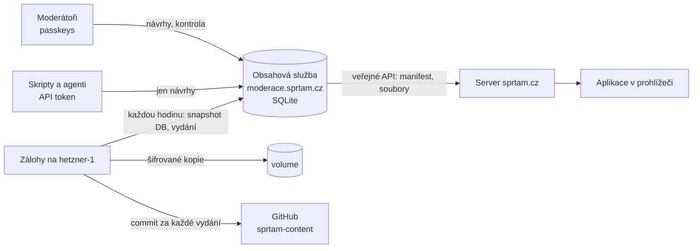

# Obsah a jeho API

Učivo Šprtámu (témata, slovíčka, plány přístupů k výuce) žije v databázi **obsahové služby**. Je to tentýž server jako [moderace](MODERACE.md) na **moderace.sprtam.cz** ([`moderator/server/`](../moderator/server)). Každá změna se ukládá jako nová verze a nic se nepřepisuje. Zveřejňuje se až po schválení jiným moderátorem. Aplikace na sprtam.cz čte učivo z veřejného API služby. Zálohy si každou hodinu stahuje druhý server.



## Dokumenty, verze, vydání

**Dokument** je jeden JSON s adresou podle dřívější cesty souboru ([`src/content/docs.ts`](../src/content/docs.ts)):

| Klíč | Obsah |
|---|---|
| `topics/<ročník>/<předmět>/<id>` | jedno téma |
| `topics/<ročník>/<předmět>/_subject` | pořadí témat předmětu |
| `vocab/<a1…c1>` | slovíčka jedné úrovně |
| `approaches/<id>/approach`, `approaches/<id>/<ročník>` | přístup k výuce a jeho plán ročníku |

Formát dokumentů se nezměnil ([FORMAT.md](FORMAT.md)).

- **Verze.** Každé zveřejnění dokumentu je nová verze (`versions`). Tabulka verzí jde jen doplňovat: SQLite triggery odmítnou každý `UPDATE` i `DELETE`.
- **Hash řetěz.** Každá verze nese SHA-256 svého obsahu a **řetěz**, tedy hash předchozího řetězu a údajů verze (klíč, číslo, hash obsahu, autor, vydání, důvod, čas). Kdo by historii přepsal, musí přepočítat řetěz až do konce. Záloha si pamatuje řetěz poslední verze, kterou viděla, a přepsání odhalí (viz [Zálohy](#zálohy)). Kontrolu ukazuje i moderace (Vydání → Historie) a příkaz `cli.mjs verify`.
- **Vydání** (`releases`) je jedno zveřejnění: jedna nebo víc nových verzí najednou, např. nové téma i s pořadím v předmětu. Vydání se číslují od 1. Vydání 1 je import učiva z repozitáře při prvním spuštění.
- **Kontrola před zveřejněním.** Před každým vydáním se zkontroluje celé učivo i se změnou, a to stejnou kontrolou jako `npm run check:content` ([`src/content/check.ts`](../src/content/check.ts)). Formát a pravidla se kontrolují u změněných dokumentů, vazby mezi dokumenty u všech: každé téma je v seznamu předmětu právě jednou, plány přístupů ukazují na existující témata, anglická slovíčka jsou jedinečná. Co neprojde, nezveřejní se.

## Zveřejnění: kontrola jiným moderátorem

1. Moderátor upraví téma v editoru (návrh, `drafts`) a pošle ho **ke kontrole**.
2. Ostatní moderátoři ho uvidí v **Ke kontrole**: změny proti verzi, ze které autor vycházel, po slovech, a návrh v telefonu. Můžou **komentovat** konkrétní blok nebo otázku, **požádat o úpravy**, nebo **schválit**.
3. Když schválí dost lidí (`REQUIRED_APPROVALS`, výchozí 1, autor se nepočítá) a nikdo nežádá úpravy, změna se **hned zveřejní** jako nové vydání.
4. Schvaluje se konkrétní **revize**. Každá úprava návrhu je nová revize a dřívější schválení i požadavky na úpravy pro ni neplatí.
5. **Konflikt:** když mezitím někdo zveřejnil jinou změnu téhož tématu, návrh nejde schválit. Autor uvidí, co se zveřejnilo, přenese to do svého návrhu a převede ho na novou verzi.

Správce může návrh zamítnout s důvodem.

## Historie a návraty

- **Historie tématu** (Učivo → téma → Historie): všechny verze, kdo je změnil a kdo schválil, a co každá verze změnila (nebo rozdíl proti zveřejněné).
- **Návrat ke starší verzi** je obyčejný návrh se starším obsahem a prochází stejnou kontrolou.
- **Správce v naléhavém případě** (s čerstvým potvrzením klíčem a s důvodem):
  - vrátí verzi tématu **hned bez kontroly**;
  - obnoví **celé učivo** do stavu po některém vydání (Vydání → Obnovit).

  Obojí je nové vydání. Nic se neztratí a jde to zase vrátit.

## Veřejné API obsahové služby

Bez přihlášení, jen pro čtení. Z něj si kopii drží server sprtam.cz (viz API pro aplikaci).

| Požadavek | Odpověď |
|---|---|
| `GET /api/public/v1/manifest` | manifest aktuálního vydání ([`src/content/manifest.ts`](../src/content/manifest.ts)), `ETag` a `304` |
| `GET /api/public/v1/files/<hash>` | soubor vydání podle hashe, `immutable`, gzip |
| `GET /api/public/v1/export` | všechny dokumenty aktuálního vydání `{ release, publishedAt, docs: { klíč: dokument } }` (`npm run content:pull`), nejvýš 30× za hodinu z jedné adresy |

## API pro moderování

Všechno, co umí moderace, jde přes JSON API na `https://moderace.sprtam.cz/api/…`. Prohlížeč posílá session cookie. Každý měnící požadavek musí mít přesně náš `Origin`, jinak skončí `403`.

**Skripty a AI agenti** (třeba ti, kdo píšou nové učivo) používají **API token**: Moderace → Účet → API tokeny. Token se zobrazí jen jednou a platí 7–180 dní. Posílá se v hlavičce `Authorization: Bearer spt_…`. Token patří moderátorovi a umí jen část toho, co on:

| Token smí | Token nesmí |
|---|---|
| číst učivo a historii (`GET /api/content/…`, `/api/history/…`, `/api/versions/:id`) | schvalovat, komentovat, žádat o úpravy |
| zakládat a upravovat **vlastní** návrhy (`POST /api/drafts`, `PUT /api/drafts/:id`) | zveřejňovat, vracet verze, obnovovat vydání |
| posílat je ke kontrole a zpět (`POST /api/drafts/:id/submit`, `/withdraw`, `/rebase`), mazat rozpracované | spravovat moderátory, tokeny a klíče |

Návrh od agenta pak musí schválit **někdo jiný než vlastník tokenu**. Agent tedy nikdy nezveřejní nic, co neviděl člověk.

Příklad: úprava tématu agentem.

```sh
API=https://moderace.sprtam.cz; H="Authorization: Bearer $SPRTAM_TOKEN"
# 1. návrh úpravy (nebo pokračování v mém otevřeném návrhu tématu)
curl -s -X POST "$API/api/drafts" -H "$H" -H 'Content-Type: application/json' \
  -d '{"kind":"edit","grade":"z6","subject":"matematika","topicId":"prvocisla"}' > draft.json
# 2. uložit nový obsah: { topic, rev } – rev z odpovědi, při souběžné změně 409 "stale"
curl -s -X PUT "$API/api/drafts/$ID" -H "$H" -H 'Content-Type: application/json' -d @body.json
# 3. ke kontrole (422 + seznam problémů, když téma neprojde kontrolou)
curl -s -X POST "$API/api/drafts/$ID/submit" -H "$H" -H 'Content-Type: application/json' -d '{"note":"Doplněny příklady"}'
```

Nové téma: `POST /api/drafts` s `{ "kind": "new", "grade", "subject", "topic": {…celé téma…}, "after": "<id tématu, za které patří>" }`. Kontrola tématu je stejná jako `npm run check:content -- topics/<ročník>/<předmět>` nad místní kopií (`npm run content:pull`).

Ostatní endpointy jsou v [`moderator/server/index.ts`](../moderator/server/index.ts): review, historie, vydání, žádosti o pomůcky, správa.

## Zálohy

Zálohy si **stahují jiné stroje**, obsahová služba je jen vydá a k žádné kopii nemá přístup. Kód je v [`ops/backup/`](../ops/backup):

- **`hetzner-1`:** kontejner „Šprtám zálohy“ v Coolify (projekt Šprtám), volume `/data`. Kromě záloh plní i git zrcadlo.
- **Mac správce:** LaunchAgent `cz.sprtam.backup` (`sh ops/backup/mac/install.sh`), kopie v `~/.local/state/sprtam-backup`. Běží, jen když je Mac zapnutý a přihlášený. Na Mac nedosáhne Coolify ani žádný ze serverů.

Každou hodinu ([`backup.py`](../ops/backup/backup.py)):

1. **Stažení.** Stáhne snapshot celé databáze (`GET /api/internal/backup`, `VACUUM INTO`, gzip) s tokenem `BACKUP_TOKEN`.
   - Přesměrování nenásleduje, takže token nikam jinam neodejde.
   - Velikost hlídá už během stahování, i po rozbalení. Zip bomba neprojde a v paměti je vždy jen kousek.
   - S `ORIGIN_IP` se spojí rovnou s původním serverem, takže snapshot nejde přes CDN. TLS se i tak ověřuje pro `moderace.sprtam.cz`.
2. **Ověření:**
   - SHA-256 sedí s ohlášeným;
   - SQLite `integrity_check` je v pořádku (soubor se otevírá jen pro čtení, s `trusted_schema=OFF` a časovým limitem);
   - každá verze má správný hash obsahu a správný klíč dokumentu;
   - přepočítaný hash řetěz sedí;
   - zveřejněné je opravdu nejnovější verze;
   - historie jen přibyla: verze z minulého běhu má pořád stejný řetěz. Když stav chybí, vezme se poslední commit zrcadla.
3. **Uložení.** Uloží snapshot zašifrovaný nástrojem [age](https://age-encryption.org) pro příjemce v `AGE_RECIPIENTS`. Privátní klíč není na žádném serveru: je v Keychainu správce (`sprtam-backup-age`) a v `~/.config/sprtam/backup-age-identity.txt`. Ponechá 48 hodinových, 35 denních a 24 měsíčních záloh. Když kontrola selže, nic starého nemaže.
4. **Zrcadlo (jen `hetzner-1`).** Každé nové vydání zapíše přímo z ověřeného snapshotu jako commit do soukromého repozitáře **`mrpajzl/sprtam-content`**:
   - soubory jako dřív v `content/`;
   - autor, kdo schválil, a trailery `Release:` a `Content-Chain:`.

   Pushuje deploy klíčem. Nikdy nepushuje force a nikdy nezačne novou historii, když repozitář nejde přečíst.
5. **Hlášení.** Výsledek nahlásí zpět (`/api/internal/backup/report`):
   - Moderace → Vydání ukazuje poslední ověřenou zálohu každé kopie, nebo **CHYBA** s důvodem;
   - když kontrola selže, kontejner na `hetzner-1` je po 2,5 hodinách „unhealthy“.

Dva běhy najednou zabrání zámek, stav se zapisuje přes `fsync` a přejmenování.

| Kde | Co |
|---|---|
| Coolify, moderace | `BACKUP_TOKEN` (aspoň 32 znaků) |
| Coolify, „Šprtám zálohy“ na `hetzner-1` | `BACKUP_TOKEN`, `AGE_RECIPIENTS`, `MIRROR_REMOTE`, `MIRROR_KEY` (soukromý deploy klíč, base64), `BACKUP_SOURCE=hetzner-1` |
| Mac správce | `~/.config/sprtam/backup-token`, `~/.config/sprtam/backup-age-identity.txt` (0600) |

Velikost: celé učivo je 11,7 MB JSON, snapshot databáze zhruba 2,5 MB gzip. Každá změna tématu přidá desítky kB.

### Obnova

1. **Výběr kopie:** nejnovější z `~/.local/state/sprtam-backup/snapshots/` na Macu, nebo z volume kontejneru na `hetzner-1` (Coolify → Šprtám zálohy → Terminal, `/data/snapshots`).
2. **Rozšifrování a kontrola** (jen čtení, nic nezmění):
   ```sh
   age -d -i ~/.config/sprtam/backup-age-identity.txt moderace-<čas>.sqlite.gz.age | gunzip > moderace.sqlite
   python3 ops/backup/backup.py verify moderace.sqlite
   ```
3. **Výměna databáze:**
   - V Coolify zastav moderaci.
   - Ve volume moderace (`/data`) přejmenuj současné `moderace.sqlite*` na `*.broken-<datum>`. Nic nemaž, je to stopa pro vyšetřování.
   - Vlož obnovený soubor jako `moderace.sqlite`, vlastník uid 1000 (`node`), práva 0600.
   - Spusť moderaci. Případné migrace proběhnou samy a předtím se uloží kopie `before-migration-*`.
4. **Zrušení přístupů:** obnovená databáze vrátí i session, API tokeny a pozvánky ze dne zálohy.
   - V Moderátorech odhlas všechny uživatele.
   - Zkontroluj účty vypnuté po datu zálohy (záznam událostí v záloze je starší, aktuální je v rozbité databázi).
5. **Zálohy po obnově starší databáze:** obě zálohy teď správně hlásí přepsanou historii. Na každém stroji to potvrď:
   ```sh
   python3 backup.py accept-reset "Obnova ze zálohy <čas>, důvod…"
   ```
   - na `hetzner-1` v terminálu kontejneru;
   - na Macu s `DATA_DIR=~/.local/state/sprtam-backup`.

   Zrcadlo má historii až do původního vydání. Nová vydání se stejnými čísly do něj nejdou. Před dalším zveřejněním proto obnov učivo ještě jednou jako nové vydání (Vydání → Obnovit poslední, nebo `cli.mjs import`), aby čísla vydání převýšila zrcadlo.
6. **Kontrola webu:** sprtam.cz převezme vydání do 15 s (`/api/content/manifest`).

**Jen učivo ze zrcadla** (účty a návrhy tam nejsou):

```sh
git clone git@github.com:mrpajzl/sprtam-content.git
```

Složku `content/` dostaň do volume moderace a v terminálu kontejneru spusť:

```sh
node moderator/dist-server/cli.mjs import /data/<složka> "<důvod>"
```

Vznikne nové vydání, pak moderaci restartuj.

Zkoušku obnovy dělej aspoň jednou za čtvrt roku: kroky 1–2 a porovnání počtu verzí s Moderace → Vydání.

## Bezpečnost

| | |
|---|---|
| Zápis učiva | Jen přes zveřejnění schváleného návrhu (jiný moderátor, aktuální revize, bez konfliktu, celé učivo projde kontrolou), nebo nouzovou obnovu správcem s čerstvým potvrzením klíčem. Všechno je v historii a v záznamu událostí. |
| Historie | Verze a vydání se jen přidávají (triggery). Hash řetěz ověřuje služba při startu, správce v moderaci a nezávisle záloha na jiném serveru. |
| Veřejné API | Jen čtení zveřejněného obsahu. Soubory se hledají jen podle hashe (20 hex znaků), takže žádná cesta. Platí limity na adresu. |
| API tokeny | Náhodných 256 bitů, v databázi jen SHA-256, s platností. Jen vybrané akce nad vlastními návrhy. Vypnutí účtu, zrušení klíčů a „Odhlásit“ ruší i tokeny. Požadavky s tokenem nenesou cookies, takže je cizí stránka nemůže poslat za někoho (bez CORS). |
| Zálohy | Stahují je jiné stroje s vlastním tokenem (aspoň 32 znaků, porovnání v konstantním čase). Jsou šifrované klíčem, který na žádném serveru není. Moderátorská session ani API token k záloze nestačí. |
| GitHub | Moderace do GitHubu nepíše a token nemá. Do zrcadla píše jen zálohovací kontejner deploy klíčem. |
| Zbytkové riziko | Coolify na hlavním serveru spravuje i `hetzner-1` (root SSH) a má v sobě `BACKUP_TOKEN` i deploy klíč zrcadla. Kdo by ovládl hlavní server nebo účet v Coolify, může smazat zálohy na `hetzner-1` i přepsat zrcadlo (soukromý repozitář na bezplatném GitHubu nejde chránit pravidly větví). Šifrované kopie ale nepřečte. Kopie na Macu správce je mimo jeho dosah. Upozornění mimo moderaci (výpadek záloh) zatím neposílá nic, stav je vidět v Moderace → Vydání a v Coolify. |
