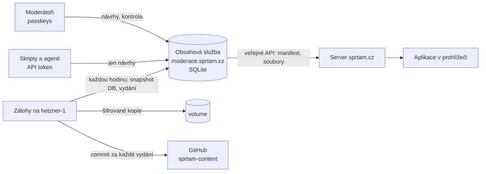

# Obsah a jeho API

Učivo Šprtámu (témata, slovíčka, plány přístupů k výuce) žije v databázi **obsahové služby**. Je to tentýž server jako [moderace](MODERACE.md) na **moderace.sprtam.cz** ([`moderator/server/`](../moderator/server)). Každá změna se ukládá jako nová verze a nic se nepřepisuje. Zveřejňuje se až po schválení jiným moderátorem. Aplikace na sprtam.cz čte učivo z veřejného API služby. Zálohy si každou hodinu stahuje druhý server.



## Licence

Učivo je pod licencí **[CC BY-SA 4.0](https://creativecommons.org/licenses/by-sa/4.0/deed.cs)** (kód aplikace pod MIT). Kdo ho použije, uvede původ (*Učivo: [Šprtám](https://sprtam.cz), CC BY-SA 4.0*) a úpravy zveřejní pod stejnou licencí. Moderátoři to odsouhlasí při každém odeslání změny ke kontrole.

Ke stažení je dvakrát:

- **[mrpajzl/sprtam-content](https://github.com/mrpajzl/sprtam-content)**: veřejné git zrcadlo, každé vydání jako commit i s autorem a tím, kdo schválil ([Zálohy](#zálohy), bod 4). README a `LICENSE` zrcadla jsou v [`ops/backup/mirror/`](../ops/backup/mirror).
- **API**: `GET https://moderace.sprtam.cz/api/public/v1/export` vrátí celé aktuální vydání ([Veřejné API](#veřejné-api-obsahové-služby)). Odpovědi veřejného API nesou hlavičku `Link: <…/by-sa/4.0/>; rel="license"`, export i pole `license`.

## Dokumenty, verze, vydání

**Dokument** je jeden JSON s adresou podle dřívější cesty souboru ([`src/content/docs.ts`](../src/content/docs.ts)):

| Klíč | Obsah |
|---|---|
| `topics/<ročník>/<předmět>/<id>` | jedno téma |
| `topics/<ročník>/<předmět>/_subject` | pořadí témat předmětu (u odborných předmětů, `topics/odb/…`, i jeho název, emoji a barva) |
| `vocab/<a1…c1>` | anglická slovíčka jedné úrovně |
| `vocab/<de\|fr\|es>/<a1…c1>` | slovíčka dalšího jazyka jedné úrovně |
| `approaches/<id>/approach`, `approaches/<id>/<ročník>` | přístup k výuce a jeho plán ročníku |

Formát dokumentů se nezměnil ([FORMAT.md](FORMAT.md)).

- **Verze.** Každé zveřejnění dokumentu je nová verze (`versions`). Tabulka verzí jde jen doplňovat: SQLite triggery odmítnou každý `UPDATE` i `DELETE`.
- **Hash řetěz.** Každá verze nese SHA-256 svého obsahu a **řetěz**, tedy hash předchozího řetězu a údajů verze (klíč, číslo, hash obsahu, autor, vydání, důvod, čas). Kdo by historii přepsal, musí přepočítat řetěz až do konce. Záloha si pamatuje řetěz poslední verze, kterou viděla, a přepsání odhalí (viz [Zálohy](#zálohy)). Kontrolu ukazuje i moderace (Vydání → Historie) a příkaz `cli.mjs verify`.
- **Vydání** (`releases`) je jedno zveřejnění: jedna nebo víc nových verzí najednou, např. nové téma i s pořadím v předmětu. Vydání se číslují od 1. Vydání 1 je import učiva z repozitáře při prvním spuštění.
- **Kontrola před zveřejněním.** Před každým vydáním se zkontroluje celé učivo i se změnou, a to stejnou kontrolou jako `npm run check:content` ([`src/content/check.ts`](../src/content/check.ts)). Formát a pravidla se kontrolují u změněných dokumentů, vazby mezi dokumenty u všech: každé téma je v seznamu předmětu právě jednou, plány přístupů ukazují na existující témata, slovíčka jsou jedinečná v rámci jazyka. Co neprojde, nezveřejní se.

## Zveřejnění: kontrola jiným moderátorem

1. Moderátor upraví téma v editoru (návrh, `drafts`) a pošle ho **ke kontrole**.
2. Ostatní moderátoři ho uvidí v **Kontrole** (karta Otevřeno): změny proti verzi, ze které autor vycházel, po slovech, a návrh v telefonu. Můžou **komentovat** konkrétní blok nebo otázku, **požádat o úpravy**, nebo **schválit**.
3. Když schválí dost lidí (`REQUIRED_APPROVALS`, výchozí 1, autor se nepočítá) a nikdo nežádá úpravy, změna se **hned zveřejní** jako nové vydání.
4. Schvaluje se konkrétní **revize**. Každá úprava návrhu je nová revize a dřívější schválení i požadavky na úpravy pro ni neplatí.
5. **Konflikt:** když mezitím někdo zveřejnil jinou změnu téhož tématu, návrh nejde schválit. Autor uvidí, co se zveřejnilo, přenese to do svého návrhu a převede ho na novou verzi.

Správce může návrh zamítnout s důvodem.

## Neověřené učivo

Učivo připravené AI nečeká na kontrolu: zveřejní se hned jako **neověřené** a člověk ho zkontroluje potom.

- Stav je přímo v tématu: pole `verified` (`by` = kdo, `at` = kdy, RRRR-MM-DD, [`src/content/verified.ts`](../src/content/verified.ts)). Téma bez něj je neověřené.
- **Zveřejnit bez kontroly** smí jen správce, a to jen svoje návrhy: `POST /api/drafts/publish-unverified` s `{ "ids": [...] }` (1–200 návrhů, jedno vydání, celé učivo projde kontrolou jako vždy). Jde to i API tokenem správce. Tudy chodí učivo od AI: `npx tsx scripts/content-propose.ts --unverified topics/odb/<předmět> …`.
- **Ověřit:** moderátor otevře téma v moderaci, projde výklad i otázky a klepne na **Ověřit** (`POST /api/content/verify` s `{ grade, subject, topicId, version }`). Vznikne nová verze tématu se jménem a datem a historie ukáže, kdo ji udělal. Jde to jen v prohlížeči, ne API tokenem, a jen u verze, kterou moderátor viděl.
- **Změna schválená v kontrole** se zveřejní jako ověřená: `by` jsou ti, kdo ji schválili. **Změna bez kontroly** stav smaže.
- Ověření není změna obsahu: rozpracovaná úprava tématu kvůli němu nespadne do konfliktu.
- **Kde je stav vidět:**
  - Moderace: úvodní stránka ukáže, kolik témat čeká na ověření, a odkaz **Ověřovat** (`/ucivo?neovereno=1`). V seznamech mají neověřená témata žlutou tečku.
  - Aplikace a stránky od serveru: pod výkladem je rámeček *Autor: Claude Opus 5.5 (umělá inteligence)* (`CONTENT_AUTHOR` v [`src/content/verified.ts`](../src/content/verified.ts); celé učivo zatím napsala AI) a pod ním buď *Zkontrolováno člověkem: jméno, datum*, nebo *Čeká na kontrolu člověkem* s tlačítkem **Chci to zkontrolovat a schválit**. To vede na formulář žádosti o moderátorství ([MODERACE.md](MODERACE.md#žádosti-o-moderátorství)).

## Historie a návraty

- **Historie tématu** (Učivo → téma → Historie): všechny verze, kdo je změnil a kdo schválil, a co každá verze změnila (nebo rozdíl proti zveřejněné).
- **Návrat ke starší verzi** je obyčejný návrh se starším obsahem a prochází stejnou kontrolou.
- **Správce v naléhavém případě** (s čerstvým potvrzením klíčem a s důvodem):
  - vrátí verzi tématu **hned bez kontroly**;
  - obnoví **celé učivo** do stavu po některém vydání (Vydání → Obnovit).

  Obojí je nové vydání. Nic se neztratí a jde to zase vrátit.

## Veřejné API obsahové služby

Bez přihlášení, jen pro čtení. Z něj si kopii drží server sprtam.cz ([API pro aplikaci](#api-pro-aplikaci)).

| Požadavek | Odpověď |
|---|---|
| `GET /api/public/v1/manifest` | manifest aktuálního vydání ([`src/content/manifest.ts`](../src/content/manifest.ts)), `ETag` a `304` |
| `GET /api/public/v1/files/<hash>` | soubor vydání podle hashe, `immutable`, gzip |
| `GET /api/public/v1/export` | všechny dokumenty aktuálního vydání `{ release, publishedAt, license, docs: { klíč: dokument } }` (`npm run content:pull`), nejvýš 30× za hodinu z jedné adresy |
| `POST /api/public/v1/reports` | hlášení chyby od žáka; jen se `REPORT_TOKEN`, posílá ho server sprtam.cz ([Hlášení chyb od žáků](#hlášení-chyb-od-žáků)) |

## Hlášení chyb od žáků

Tlačítko **Nahlásit chybu** v aplikaci (u otázky po odpovědi a u vysvětlení) posílá hlášení na server sprtam.cz, nikdy rovnou do obsahové služby:

```
POST /api/report
{ "topic": "z5/matematika/zlomky",
  "target": { "kind": "question", "index": 3, "text": "znění otázky" },   // nebo "explanation" a název vysvětlení
  "reason": "wrong" | "unclear" | "typo" | "other",
  "note": "nepovinná poznámka, nejvýš 500 znaků",
  "release": 12 }                                                         // vydání, které žák viděl
```

1. Server sprtam.cz ([`server/index.ts`](../server/index.ts), kontrola v [`server/report.ts`](../server/report.ts)) ověří, že téma je v aktuálním vydání a pole dávají smysl (tělo nejvýš 4 kB). Odpoví `204`, při chybě JSON `{ error }` s českou zprávou.
2. Omezí počet: z jednoho zařízení nejvýš 5 hlášení za 10 minut a 20 za den, ze všech dohromady 500 za den. Počítá v paměti podle otisku adresy (SHA-256), který nikam neukládá a do dne zapomene.
3. Pošle dál **jen hlášení samotné** na `POST /api/public/v1/reports` s `Authorization: Bearer REPORT_TOKEN` (timeout 10 s). Adresu, prohlížeč ani nic jiného o žákovi neposílá.
4. Obsahová služba ([`moderator/server/reports.ts`](../moderator/server/reports.ts)) hlášení znovu zkontroluje a uloží do tabulky `reports` (nejvýš 1000 otevřených). Moderátoři je vidí na záložce Hlášení ([MODERACE.md](MODERACE.md#hlášení-od-žáků)).

Bez `REPORT_TOKEN` (na kterékoli straně) nebo když obsahová služba neodpoví, aplikace dostane `503` *Hlášení teď nejde poslat. Zkus to později.*

| Kde | Co |
|---|---|
| Coolify, sprtam.cz i moderace | `REPORT_TOKEN`, na obou stejná hodnota (aspoň 32 znaků) |

API pro moderátory (přihlášení v prohlížeči): `GET /api/reports?status=open|closed&grade=&subject=&topic=`, `GET /api/reports/counts`, `PATCH /api/reports/<id>` `{ status: "open" | "fixed" | "dismissed", note? }`.

## API pro aplikaci

Aplikace na sprtam.cz nemá učivo zabudované v sobě. Bere ho za běhu od serveru sprtam.cz, který si drží ověřenou kopii aktuálního **vydání** učiva z obsahové služby ([`server/content.ts`](../server/content.ts)). Vydání je neměnná sada souborů. Každý soubor se jmenuje podle hashe svého obsahu, takže se může cachovat navždy a nové vydání znamená jen nové názvy.

### Manifest

`GET /api/content/manifest` vrátí manifest aktuálního vydání ([`src/content/manifest.ts`](../src/content/manifest.ts)):

```json
{
  "format": 1,
  "release": 42,
  "hash": "f55f0e8e91a9ccf87c6c",
  "publishedAt": 1793001234567,
  "files": { "subject/z5/matematika": "1c9b…", "index": "8f20…", "vocab/A1": "…", "approach/waldorf/z1": "…" },
  "approaches": [{ "id": "waldorf", "name": "Waldorfská škola", "short": "Waldorf", "emoji": "🌳", "grades": ["z1", "…"], "…": "…" }],
  "vocational": { "programovani": { "name": "Programování", "emoji": "🧑‍💻", "c": "green" } }
}
```

- `Cache-Control: no-cache` a `ETag: "<hash>"`, takže opakovaný dotaz s `If-None-Match` dostane `304`.
- Server manifest vkládá i do každé stránky jako datový blok `<script type="application/json" id="sprtam-manifest">`. Aplikace tak nemusí čekat na další dotaz. Blok se nespouští, takže CSP `script-src 'self'` zůstává.
- Dokud server nemá žádné vydání (první start a nedostupná obsahová služba), vrací `503` s `Retry-After`. Stejně odpovídá i na stránky.

### Soubory vydání

`GET /api/content/f/<hash>.json` vrátí jeden soubor: kompaktní JSON s `Cache-Control: public, max-age=31536000, immutable`, podle `Accept-Encoding` komprimovaný brotli nebo gzip. Neznámý hash vrátí `404`.

| Název v `files` | Obsah |
|---|---|
| `subject/<ročník>/<předmět>` | témata předmětu v pořadí, v jakém se učí (`Topic[]`); ročník `odb` = odborné předměty |
| `index` | řádek za každé téma: `[ročník, předmět, id, název, emoji, přístup?]` (hledání, doporučení) |
| `text` | ve stejném pořadí jako `index`: názvy vysvětlení, pojmy a shrnutí (hledání) |
| `vocab/<úroveň>` | anglická slovíčka jedné úrovně A1–C1 |
| `words/<jazyk>/<úroveň>` | slovíčka dalšího jazyka (de, fr, es). Ne pod `vocab/`: starší aplikace berou všechny soubory `vocab/` jako angličtinu |
| `approach/<přístup>/<ročník>` | plán ročníku přístupu k výuce (epochy a jejich témata) |

Popisy přístupů k výuce a názvy odborných předmětů jsou malé a aplikace je potřebuje hned při startu, proto jsou přímo v manifestu (`approaches`, `vocational`; ten chybí ve vydáních bez odborných předmětů).

Ze stejných dokumentů vznikají vždy stejné soubory i hashe ([`src/content/release.ts`](../src/content/release.ts)). Server zná soubory posledních deseti vydání, takže je dostane i stránka otevřená před vydáním nového.

### Jak aplikace učivo načítá

[`src/content/remote.ts`](../src/content/remote.ts):

1. **Manifest** bere z bloku ve stránce. Offline se otevře kostra `app.html` z cache, která blok nemá. Pak aplikace použije novější z manifestu, který si naposledy uložila do `localStorage`, a toho, kterým odpoví service worker (`NetworkFirst`, 3 s).
2. **Soubory** stahuje podle hashe, až jsou potřeba, a v rámci návštěvy je drží v paměti.
3. **Offline:** jakmile má prohlížeč volnou chvíli, uloží všechny soubory aktuálního vydání do cache `content` a soubory starších vydání smaže. Service worker je pak obsluhuje z cache (`CacheFirst`). Po jedné návštěvě je offline k dispozici celé učivo ([`scripts/offline-test.mjs`](../scripts/offline-test.mjs)).
4. **Nové vydání:** když se aplikace vrátí na obrazovku nebo každých 10 minut, zeptá se na manifest přímo sítě (`/api/content/manifest?fresh`, mimo cache service workeru). Jiné vydání použije pro všechno, co se načte potom.

### Jak server drží kopii

Server se každých 15 s zeptá obsahové služby (`CONTENT_API`, výchozí `https://moderace.sprtam.cz`) na její manifest s `If-None-Match`. Když přijde nové vydání:

1. Stáhne soubory, které ještě nemá (`/api/public/v1/files/<hash>`, nejvýš 32 MB na soubor, timeout 20 s).
2. Ověří, že SHA-256 obsahu odpovídá hashi v názvu a že jde o platný JSON.
3. Zapíše je do `DATA_DIR/content/files/` (vždy přes dočasný soubor a přejmenování).
4. Z celého vydání vykreslí stránky.

Teprve pak na nové vydání přepne. Když cokoli selže, zůstane u předchozího vydání a zkusí to znovu při dalším dotazu. Rozbité nebo podvržené soubory se tak na web nikdy nedostanou.

Po restartu server okamžitě naběhne z uložené kopie (`DATA_DIR/content/releases.json`), takže web funguje, i když obsahová služba zrovna neběží.

Obsahová služba je pro server autorita. Převezme od ní jakékoli jiné vydání, i s nižším číslem (např. po obnově její databáze ze zálohy). Stejně tak aplikace v prohlížeči: za běhu se ptá jen sítě, nikdy cache. Server odmítne a nepoužije vydání, které má neplatný manifest nebo nesmyslné číslo, přesahuje limity (2000 souborů, 32 MB na soubor, 100 MB celkem) nebo ve kterém cokoli, co se dostane do adres (ročníky, předměty, úrovně, id témat, epoch a přístupů), neodpovídá tomu, co aplikace zná. Veškerý text učiva ve stránkách je escapovaný.

### Vývoj

- `npm run content:pull` stáhne aktuální vydání (`/api/public/v1/export`) do `content/` jako soubory ve stejném formátu jako dřív v gitu (s `$schema`). Kopie není v gitu a další `content:pull` ji přepíše. Změny učiva jdou přes moderaci.
- `npm run dev` obsluhuje `/api/content/*` ze složky `content/` a po každé změně souboru stránku obnoví ([`plugins/content-dev.ts`](../plugins/content-dev.ts)). Když místní kopie chybí, přeposílá dotazy na `CONTENT_API`.
- `npx tsx scripts/content-stub.ts` nahrazuje veřejné API obsahové služby nad `content/` (manifest, soubory, export) pro testy produkčního serveru: `CONTENT_API=http://localhost:8097 npm start`.

## API pro moderování

Všechno, co umí moderace, jde přes JSON API na `https://moderace.sprtam.cz/api/…`. Prohlížeč posílá session cookie. Každý měnící požadavek musí mít přesně náš `Origin`, jinak skončí `403`.

**Skripty a AI agenti** (třeba ti, kdo píšou nové učivo) používají **API token**: Moderace → Účet → API tokeny. Token se zobrazí jen jednou a platí 7–180 dní. Posílá se v hlavičce `Authorization: Bearer spt_…`. Token patří moderátorovi a umí jen část toho, co on:

| Token smí | Token nesmí |
|---|---|
| číst učivo a historii (`GET /api/content/…`, `/api/history/…`, `/api/versions/:id`) | schvalovat, komentovat, žádat o úpravy |
| zakládat a upravovat **vlastní** návrhy (`POST /api/drafts`, `PUT /api/drafts/:id`) | zveřejňovat, vracet verze, obnovovat vydání |
| posílat je ke kontrole a zpět (`POST /api/drafts/:id/submit`, `/withdraw`, `/rebase`), mazat rozpracované | spravovat moderátory, tokeny a klíče |

Návrh od agenta pak musí schválit člověk v moderaci: **jiný moderátor**, nebo – je-li vlastník tokenu správce – správce sám v prohlížeči s potvrzením klíčem. Agent tedy nikdy nezveřejní nic, co neviděl člověk.

Příklad: úprava tématu agentem.

```sh
API=https://moderace.sprtam.cz; H="Authorization: Bearer $SPRTAM_TOKEN"
# 1. návrh úpravy (nebo pokračování v mém otevřeném návrhu tématu)
curl -s -X POST "$API/api/drafts" -H "$H" -H 'Content-Type: application/json' \
  -d '{"kind":"edit","grade":"z6","subject":"matematika","topicId":"prvocisla"}' > draft.json
# 2. uložit nový obsah: { topic, rev } – rev z odpovědi, při souběžné změně 409 "stale"
curl -s -X PUT "$API/api/drafts/$ID" -H "$H" -H 'Content-Type: application/json' -d @body.json
# 3. ke kontrole (422 + seznam problémů, když téma neprojde kontrolou)
curl -s -X POST "$API/api/drafts/$ID/submit" -H "$H" -H 'Content-Type: application/json' -d '{"note":"Doplněny příklady"}'
```

Nové téma: `POST /api/drafts` s `{ "kind": "new", "grade", "subject", "topic": {…celé téma…}, "after": "<id tématu, za které patří>" }`. Kontrola tématu je stejná jako `npm run check:content -- topics/<ročník>/<předmět>` nad místní kopií (`npm run content:pull`).

**Nový odborný předmět** ([OBORY.md](OBORY.md)): nová témata s `"grade": "odb"` a id předmětu, který ještě neexistuje, navíc pošlou `"subjectMeta": { "name", "emoji", "color" }`. Předmět založí to z nich, které se schválí první. Volitelné `"order": ["id1", "id2", …]` je zamýšlené pořadí témat předmětu: témata schválená v libovolném pořadí v něm skončí. Recenzent vidí v hlavičce návrhu „zakládá odborný předmět…“. Správce nemá omezený počet rozpracovaných návrhů (moderátor jich smí mít 50) ani počet odeslání ke kontrole za hodinu (moderátor 30), takže může najednou nahrát celý předmět: `npx tsx scripts/content-propose.ts topics/odb/<předmět> …` ([OBORY.md](OBORY.md)).

Ostatní endpointy jsou v [`moderator/server/index.ts`](../moderator/server/index.ts): review, historie, vydání, žádosti o pomůcky, správa.

## Zálohy

Zálohy si **stahují jiné stroje**, obsahová služba je jen vydá a k žádné kopii nemá přístup. Kód je v [`ops/backup/`](../ops/backup):

- **`hetzner-1`:** kontejner „Šprtám zálohy“ v Coolify (projekt Šprtám), volume `/data`. Kromě záloh plní i git zrcadlo.
- **Mac správce:** LaunchAgent `cz.sprtam.backup` (`sh ops/backup/mac/install.sh`), kopie v `~/.local/state/sprtam-backup`. Běží, jen když je Mac zapnutý a přihlášený. Na Mac nedosáhne Coolify ani žádný ze serverů.

Každou hodinu ([`backup.py`](../ops/backup/backup.py)):

1. **Stažení.** Stáhne snapshot celé databáze (`GET /api/internal/backup`, `VACUUM INTO`, gzip) s tokenem `BACKUP_TOKEN`.
   - Přesměrování nenásleduje, takže token nikam jinam neodejde.
   - Velikost hlídá už během stahování, i po rozbalení. Zip bomba neprojde a v paměti je vždy jen kousek.
   - S `ORIGIN_IP` se spojí rovnou s původním serverem, takže snapshot nejde přes CDN. TLS se i tak ověřuje pro `moderace.sprtam.cz`.
2. **Ověření:**
   - SHA-256 sedí s ohlášeným;
   - SQLite `integrity_check` je v pořádku (soubor se otevírá jen pro čtení, s `trusted_schema=OFF` a časovým limitem);
   - každá verze má správný hash obsahu a správný klíč dokumentu;
   - přepočítaný hash řetěz sedí;
   - zveřejněné je opravdu nejnovější verze;
   - historie jen přibyla: verze z minulého běhu má pořád stejný řetěz. Když stav chybí, vezme se poslední commit zrcadla.
3. **Uložení.** Uloží snapshot zašifrovaný nástrojem [age](https://age-encryption.org) pro příjemce v `AGE_RECIPIENTS`. Privátní klíč není na žádném serveru: je v Keychainu správce (`sprtam-backup-age`) a v `~/.config/sprtam/backup-age-identity.txt`. Ponechá 48 hodinových, 35 denních a 24 měsíčních záloh. Když kontrola selže, nic starého nemaže.
4. **Zrcadlo (jen `hetzner-1`).** Každé nové vydání zapíše přímo z ověřeného snapshotu jako commit do veřejného repozitáře **[`mrpajzl/sprtam-content`](https://github.com/mrpajzl/sprtam-content)**:
   - soubory jako dřív v `content/`;
   - autor, kdo schválil, a trailery `Release:` a `Content-Chain:`;
   - README a licence z [`ops/backup/mirror/`](../ops/backup/mirror). Jejich změnu zapíše samostatným commitem s trailery posledního vydání, takže pozice zrcadla zůstane.

   Pushuje deploy klíčem. Nikdy nepushuje force a nikdy nezačne novou historii, když repozitář nejde přečíst.
5. **Hlášení.** Výsledek nahlásí zpět (`/api/internal/backup/report`):
   - Moderace → Vydání ukazuje poslední ověřenou zálohu každé kopie, nebo **CHYBA** s důvodem;
   - když kontrola selže, kontejner na `hetzner-1` je po 2,5 hodinách „unhealthy“.

Dva běhy najednou zabrání zámek, stav se zapisuje přes `fsync` a přejmenování.

| Kde | Co |
|---|---|
| Coolify, moderace | `BACKUP_TOKEN` (aspoň 32 znaků) |
| Coolify, „Šprtám zálohy“ na `hetzner-1` | `BACKUP_TOKEN`, `AGE_RECIPIENTS`, `MIRROR_REMOTE`, `MIRROR_KEY` (soukromý deploy klíč, base64), `BACKUP_SOURCE=hetzner-1` |
| Mac správce | `~/.config/sprtam/backup-token`, `~/.config/sprtam/backup-age-identity.txt` (0600) |

Velikost: celé učivo je 11,7 MB JSON, snapshot databáze zhruba 2,5 MB gzip. Každá změna tématu přidá desítky kB.

### Obnova

1. **Výběr kopie:** nejnovější z `~/.local/state/sprtam-backup/snapshots/` na Macu, nebo z volume kontejneru na `hetzner-1` (Coolify → Šprtám zálohy → Terminal, `/data/snapshots`).
2. **Rozšifrování a kontrola** (jen čtení, nic nezmění):
   ```sh
   age -d -i ~/.config/sprtam/backup-age-identity.txt moderace-<čas>.sqlite.gz.age | gunzip > moderace.sqlite
   python3 ops/backup/backup.py verify moderace.sqlite
   ```
3. **Výměna databáze:**
   - V Coolify zastav moderaci.
   - Ve volume moderace (`/data`) přejmenuj současné `moderace.sqlite*` na `*.broken-<datum>`. Nic nemaž, je to stopa pro vyšetřování.
   - Vlož obnovený soubor jako `moderace.sqlite`, vlastník uid 1000 (`node`), práva 0600.
   - Spusť moderaci. Případné migrace proběhnou samy a předtím se uloží kopie `before-migration-*`.
4. **Zrušení přístupů:** obnovená databáze vrátí i session, API tokeny a pozvánky ze dne zálohy.
   - V Moderátorech odhlas všechny uživatele.
   - Zkontroluj účty vypnuté po datu zálohy (záznam událostí v záloze je starší, aktuální je v rozbité databázi).
5. **Zálohy po obnově starší databáze:** obě zálohy teď správně hlásí přepsanou historii. Na každém stroji to potvrď:
   ```sh
   python3 backup.py accept-reset "Obnova ze zálohy <čas>, důvod…"
   ```
   - na `hetzner-1` v terminálu kontejneru;
   - na Macu s `DATA_DIR=~/.local/state/sprtam-backup`.

   Zrcadlo má historii až do původního vydání. Nová vydání se stejnými čísly do něj nejdou. Před dalším zveřejněním proto obnov učivo ještě jednou jako nové vydání (Vydání → Obnovit poslední, nebo `cli.mjs import`), aby čísla vydání převýšila zrcadlo.
6. **Kontrola webu:** sprtam.cz převezme vydání do 15 s (`/api/content/manifest`).

**Jen učivo ze zrcadla** (účty a návrhy tam nejsou):

```sh
git clone git@github.com:mrpajzl/sprtam-content.git
```

Složku `content/` dostaň do volume moderace a v terminálu kontejneru spusť:

```sh
node moderator/dist-server/cli.mjs import /data/<složka> "<důvod>"
```

Vznikne nové vydání, pak moderaci restartuj.

Zkoušku obnovy dělej aspoň jednou za čtvrt roku: kroky 1–2 a porovnání počtu verzí s Moderace → Vydání.

## Bezpečnost

| | |
|---|---|
| Zápis učiva | Jen přes zveřejnění schváleného návrhu (jiný moderátor, aktuální revize, bez konfliktu, celé učivo projde kontrolou), přes zveřejnění vlastních návrhů správcem jako neověřené (i API tokenem správce – takový token je proto potřeba chránit jako heslo), přes ověření tématu v prohlížeči, nebo nouzovou obnovu správcem s čerstvým potvrzením klíčem. Všechno je v historii a v záznamu událostí. |
| Historie | Verze a vydání se jen přidávají (triggery). Hash řetěz ověřuje služba při startu, správce v moderaci a nezávisle záloha na jiném serveru. |
| Veřejné API | Jen čtení zveřejněného obsahu. Soubory se hledají jen podle hashe (20 hex znaků), takže žádná cesta. Platí limity na adresu. |
| API tokeny | Náhodných 256 bitů, v databázi jen SHA-256, s platností. Jen vybrané akce nad vlastními návrhy. Vypnutí účtu, zrušení klíčů a „Odhlásit“ ruší i tokeny. Požadavky s tokenem nenesou cookies, takže je cizí stránka nemůže poslat za někoho (bez CORS). |
| Zálohy | Stahují je jiné stroje s vlastním tokenem (aspoň 32 znaků, porovnání v konstantním čase). Jsou šifrované klíčem, který na žádném serveru není. Moderátorská session ani API token k záloze nestačí. |
| GitHub | Moderace do GitHubu nepíše a token nemá. Do zrcadla píše jen zálohovací kontejner deploy klíčem. |
| Zbytkové riziko | Coolify na hlavním serveru spravuje i `hetzner-1` (root SSH) a má v sobě `BACKUP_TOKEN` i deploy klíč zrcadla. Kdo by ovládl hlavní server nebo účet v Coolify, může smazat zálohy na `hetzner-1` i přepsat zrcadlo (soukromý repozitář na bezplatném GitHubu nejde chránit pravidly větví). Šifrované kopie ale nepřečte. Kopie na Macu správce je mimo jeho dosah. Upozornění mimo moderaci (výpadek záloh) zatím neposílá nic, stav je vidět v Moderace → Vydání a v Coolify. |
