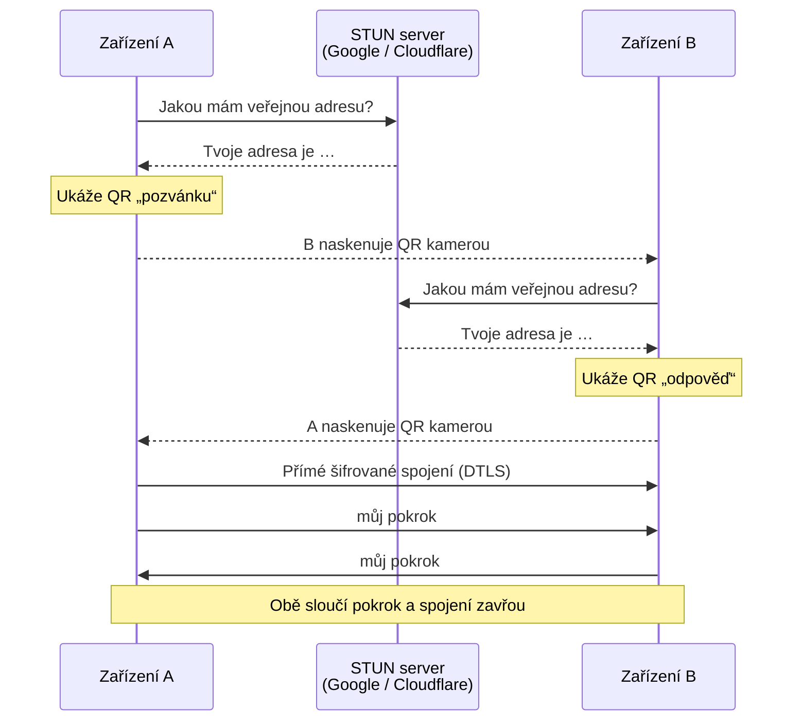

# Přenos pokroku mezi zařízeními

> **Ve zkratce:** Šprtám nemá účty, takže pokrok nemůže „žít v cloudu“. Když se chceš učit na telefonu i na počítači, přeneseš pokrok jedním ze dvou způsobů: **propojením dvou zařízení** (napřímo, přes naskenované QR kódy) nebo **kódem pokroku** (QR kód nebo odkaz). Ani jeden z nich neposílá tvůj pokrok na náš server.

Obojí najdeš na obrazovce **Přenést pokrok** (`/sdilet`). Kód: [`src/screens/Sync.tsx`](../src/screens/Sync.tsx).

| | Propojit dvě zařízení | Kód pokroku |
|---|---|---|
| Co přenese | **Všechno**: výsledky, počty kol, data, připnutá témata, sérii dní, slovíčka | **Zjednodušeně**: hvězdičky u témat, oblíbené vysvětlení, slovíčka, ročník |
| Směr | Oběma směry najednou, obě zařízení skončí se stejnými výsledky | Jedním směrem, do zařízení, které kód načte |
| Potřebuješ | Obě zařízení u sebe, na obou kameru, internet | Jen kód (lze poslat i na dálku) |
| Kudy jdou data | Přímo ze zařízení do zařízení, šifrovaně | V kódu samotném (QR nebo odkaz) |

## Propojit dvě zařízení

### Jak to funguje, lidsky

Představ si, že si dvě zařízení potřebují zavolat, ale neznají si číslo. Neexistuje žádná ústředna (server), která by je spojila. Tak si čísla **ukážou na displeji**:

1. **Zařízení A** vytvoří „pozvánku“ a ukáže ji jako QR kód.
2. **Zařízení B** ho naskenuje běžným fotoaparátem, který otevře odkaz v prohlížeči, a ukáže svou „odpověď“, taky jako QR kód.
3. **Zařízení A** naskenuje odpověď. Teď o sobě vědí a spojí se **přímo**.
4. Obě si pošlou svůj pokrok, každé ho sloučí se svým a spojení se ukončí.

Technicky je to [WebRTC](https://developer.mozilla.org/docs/Web/API/WebRTC_API), stejná technologie, jakou používají videohovory v prohlížeči. Kód: [`src/progress/p2p.ts`](../src/progress/p2p.ts).

Plné šipky jdou po síti, přerušované přes kameru (z displeje do displeje).

**Pozor na iPhonu:** odkaz naskenovaný fotoaparátem se otevře v Safari. Pokud používáš Šprtám jako aplikaci přidanou na plochu, má vlastní úložiště oddělené od Safari, a pokrok by se tak spojil se Safari, ne s aplikací. V takovém případě je jednodušší použít jako zařízení B jiné zařízení, nebo kód pokroku.

### Co je v QR kódech

QR kód obsahuje odkaz `https://sprtam.cz/#/spojit/<kód>` (pozvánka) nebo jen `<kód>` (odpověď). Kód je zabalený a zkomprimovaný [popis spojení WebRTC (SDP)](https://developer.mozilla.org/docs/Glossary/SDP), který obsahuje:

- **síťové adresy**, na kterých je zařízení k zastižení: veřejnou IP adresu a port, které zjistil STUN server, a místní adresu v síti (moderní prohlížeče ji obvykle skryjí za náhodné jméno typu `…local`),
- **otisk šifrovacího klíče** pro toto jedno spojení,
- technické údaje (podporované formáty, identifikátory).

**Pokrok v QR kódech není.** Ten jde až po otevření přímého spojení.

Kdo tvůj QR kód vyfotí, uvidí tedy tvou veřejnou IP adresu, stejně jako ji vidí každý web, který navštívíš. Připojit se k tobě ale nemůže: spojení přijme jen zařízení, jehož odpověď naskenuješ ty.

### Šifrování a bezpečnost

- Spojení je **šifrované** protokolem DTLS, který je u WebRTC povinný a nejde vypnout.
- Otisky klíčů si zařízení vyměňují **přes kameru**, ne přes internet. Nikdo po cestě je tedy nemůže podvrhnout. Útočník by musel fyzicky vidět a vyměnit QR kód na tvém displeji.
- Pozvánka platí, jen dokud je otevřená obrazovka, která ji ukazuje. Po zavření nebo dokončení přestane fungovat a nejde použít znovu.
- Párovací odkaz je za `#`, takže když ho druhé zařízení otevře, náš server se kód nedozví (viz [Soukromí](SOUKROMI.md#odkazy-s-kódem)).

### STUN server

Zařízení za domácím routerem nebo na mobilních datech nezná svou veřejnou adresu. Zeptá se proto veřejného **STUN serveru**:

- `stun.l.google.com:19302` (Google)
- `stun.cloudflare.com:3478` (Cloudflare)

STUN server se dozví tvou veřejnou IP adresu (bez ní by ti nemohl odpovědět) a že se tvoje zařízení chystá na WebRTC spojení. **Nedozví se nic o pokroku, o druhém zařízení ani o tom, že jde o Šprtám.** Data přes něj nikdy nejdou.

Nepoužíváme žádný TURN server (přeposílací server). Data proto vždy jdou jen napřímo, nikdy přes cizí počítač. Daní za to je, že v některých sítích se spojení nepodaří (viz níže).

### Co se pošle a jak se to sloučí

Každé zařízení pošle celý svůj pokrok (obsah `sprtam:progress`, viz [Soukromí](SOUKROMI.md#co-se-ukládá-ve-tvém-zařízení)). Vzhled (světlý nebo tmavý) se nepřenáší. Obě strany pak pokrok sloučí stejným pravidlem: **u každé položky vyhrává lepší nebo novější**. Kód: funkce `merge` v [`src/progress/store.ts`](../src/progress/store.ts).

| Položka | Pravidlo |
|---|---|
| Nejlepší výsledek tématu | vyšší z obou |
| Počet procvičených kol | vyšší z obou |
| Den posledního procvičení | novější |
| Oblíbené vysvětlení a výsledek posledního kola | ze zařízení, kde se téma procvičovalo naposledy (při shodném dni si každé nechá svoje) |
| Přihrádka slovíčka | vyšší z obou |
| Připnutí a odepnutí tématu | platí novější akce (ukládá se s časem změny) |
| Dny procvičování (série) | sjednocení obou, posledních 120 dní, kdy se procvičovalo |
| Zvolený ročník | každé zařízení si nechá svůj (zařízení bez zvoleného ročníku převezme ten z druhého) |

Nic se nesmaže. Sloučení jde bezpečně opakovat kolikrát chceš.

### Když se spojení nepovede

Přímé spojení někdy nejde navázat, třeba ve školní nebo firemní síti, která WebRTC blokuje, nebo když jsou obě zařízení za přísným NATem mobilního operátora. Aplikace pak napíše *„Přímé spojení se nepovedlo“*. Co pomáhá:

1. Připojit obě zařízení ke **stejné Wi-Fi**.
2. Nebo použít **kód pokroku**.

## Kód pokroku

Kód pokroku zabalí tvůj pokrok do krátkého textu, který se vejde do QR kódu nebo odkazu `https://sprtam.cz/#/p/<kód>`. Druhé zařízení ho naskenuje, vloží nebo otevře odkaz a pokrok se **sloučí** se stávajícím (stejně jako výše, nic se nepřepíše). Kód: [`src/progress/code.ts`](../src/progress/code.ts).

### Co v kódu je

Aby byl kód co nejkratší, nese jen to nejdůležitější:

- naposledy zvolený ročník,
- u každého tématu, kde máš aspoň hvězdičku nebo oblíbené vysvětlení: **počet hvězdiček (0–3)** a **které vysvětlení ti víc sedí**,
- u každého slovíčka, které už umíš: **přihrádku (1–5)**.

Každá položka zabere jen 3 bajty: 21bitový otisk (hash) názvu tématu nebo slovíčka a 3 bity stavu. Přijímající aplikace otisky přeloží zpátky podle svého seznamu témat a slov. Na začátku kódu je kontrolní součet (zkrácený SHA-256), takže překlep nebo useknutý kód aplikace odmítne a nenačte nesmysl.

**Co se nepřenese:** připnutá témata, série dní, přesné procentuální výsledky (z hvězdiček se dopočítá 40 / 70 / 90 %), počty kol a data procvičení (načtená témata se tváří jako procvičená v den načtení). Pro úplný přenos použij **Propojit dvě zařízení**.

Když je pokroku moc a odkaz by byl delší než asi 2 800 znaků, QR kód se nezobrazí. Pak použij propojení zařízení nebo pošli odkaz.

### Je kód tajný?

**Ne, kód není šifrovaný.** Je jen zakódovaný a seznam témat i slovíček je veřejný, takže kdo kód má, může zjistit, jaké hvězdičky máš u kterých témat. Neobsahuje ale nic osobního: žádné jméno, e-mail, zařízení ani časy.

Na server se kód nedostane (je za `#`). Když ho ale posíláš přes chat nebo e-mail, uvidí ho ta služba a příjemce.

## Přechod ze staré adresy

Šprtám dřív běžel na `sprtam.ondrejzraly.cz`. Prohlížeč drží data každé domény zvlášť, takže když jsi aplikaci otevřel na staré adrese, server ti poslal malý skript [`public/move.js`](../public/move.js). Ten:

1. přečte tvůj pokrok a vzhled z úložiště staré domény,
2. zabalí je do odkazu `https://sprtam.cz/…#/presun/<kód>` (za `#`, takže server je nevidí),
3. smaže service worker a cache staré domény a přesměruje tě na novou adresu,
4. nová adresa pokrok sloučí se svým ([`src/app.tsx`](../src/app.tsx), `MoveIn`).

Na rozdíl od kódu pokroku se tu přenáší celý pokrok. Data přitom neopustí tvůj prohlížeč, jen se zkopírují z jedné domény na druhou. Úložiště staré domény se nemaže: pokrok tam zůstane, dokud data webu `sprtam.ondrejzraly.cz` v prohlížeči nevymažeš.

## Ověření

Ruční testovací skripty (spouštějí se při vývoji, viz [Architektura](ARCHITEKTURA.md#vývoj)):

- [`scripts/p2p-test.mjs`](../scripts/p2p-test.mjs) ověří, že se dva oddělené prohlížeče spojí přes WebRTC jen pomocí obsahu QR kódů a pošlou si zprávu,
- [`scripts/code-test.mjs`](../scripts/code-test.mjs) ověří kód pokroku tam a zpět včetně odmítnutí poškozeného kódu.
